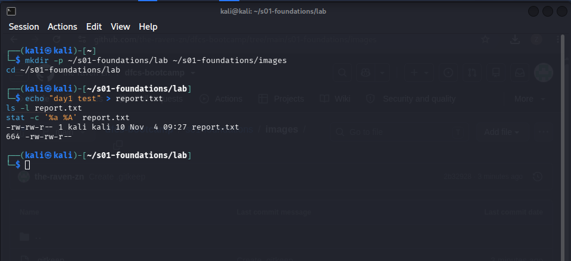
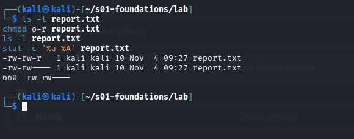
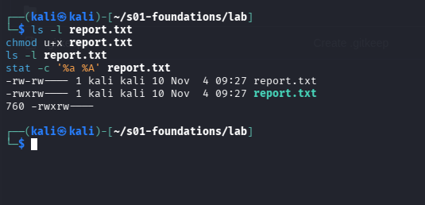
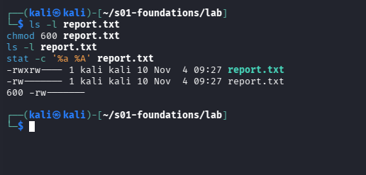
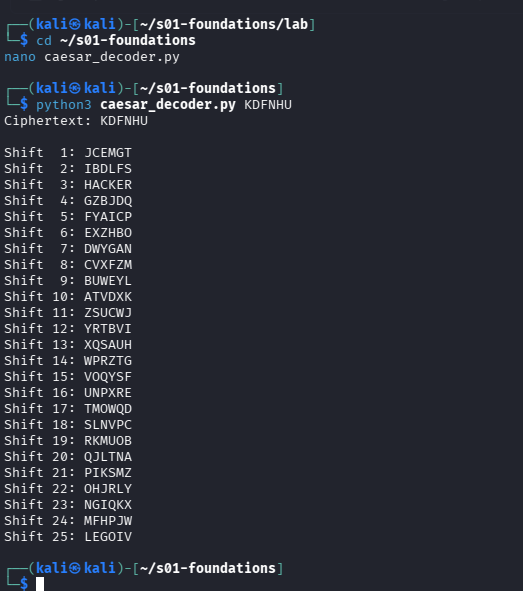

# DFCS Session 1 – Homework (Day 1: Foundations, Linux & Networks)

**Name:** MUHAMMAD ZAIN NASIR  
**Cohort / Programme:** Atomcamp – Digital Forensics & Cyber Security  
**Submitted:** Wednesday 04 November 2026  
**Contents:** Task A (compulsory) · Task B2 · Task B3

---

## Task A – Malware types and examples

*All links were opened on 4 November 2026. Each row's sources are in its last cell.*

| Type | Definition (in my own words) | Named example + year (who it targeted) | How it spread | Primary impact |
|---|---|---|---|---|
| **Virus** | Needs a host: it hides inside a normal program file and only spreads when someone runs or shares that infected file. | **CIH / Chernobyl, 1998.** Written by Chen Ing-hau, a student in Taiwan. Targeted PCs running Windows 95/98/ME (Windows NT was not affected). | Infected Windows executable (.exe) files. Spread with shared and pirated software, and some infected files even shipped inside commercial products. | On its trigger date (26 April in the common variant) it overwrote hard-disk data and, on some motherboards, corrupted the flash BIOS so the PC would not boot. Sources: [Kaspersky](https://www.kaspersky.es/about/press-releases/summary-for-april-26), [Tom's Hardware](https://tomshardware.com/tech-industry/cyber-security/the-chernobyl-virus-turned-27-today-and-it-could-brick-your-pc-in-ways-modern-malware-cant), [The Register 1999](https://www.theregister.co.uk/1999/04/26/hooray_hooray_it_s_cih/), [Wikipedia](https://en.wikipedia.org/wiki/CIH_(computer_virus)) |
| **Worm** | Copies itself across the network on its own, with no host file and no user click needed. | **SQL Slammer (Sapphire), January 2003.** Targeted internet-facing Microsoft SQL Server 2000 / MSDE servers that were not patched. | One small UDP packet to port 1434 exploited a buffer overflow in a SQL Server service that had been patched about six months earlier. Every infected server kept firing copies at other addresses. | Reached about 90% of vulnerable hosts in roughly 10 minutes. The traffic flood took most of Bank of America's 13,000 ATMs offline and disrupted airline systems. The damage was to availability, not data theft. Sources: [Panko, AIS 2003](https://core.ac.uk/download/301376982.pdf), [The Register](https://www.theregister.com/2003/01/27/atms_isps_hit_by_slammer/), [InfoWorld](https://www.infoworld.com/article/2281994/exorcizing-the-ghost-of-slammer.html) |
| **Trojan** | Looks like something harmless or useful, but does something else once the user runs it. | **Zeus (Zbot), first identified July 2007.** Targeted Windows users of online banking (first seen stealing data from the US Department of Transportation). | Drive-by downloads and phishing emails. | Man-in-the-browser keystroke logging and form grabbing to steal banking logins. In October 2010 the FBI announced action against an Eastern European gang using it. Sources: [Tech Monitor](https://techmonitor.ai/?p=105835), [Wikipedia](https://en.wikipedia.org/wiki/Zeus_(malware)) |
| **Ransomware** | Locks your own data (usually by encrypting it) and sells you the way back. | **WannaCry, 12 May 2017.** Targeted unpatched Windows systems worldwide. NHS England was hit hard (more than a third of NHS organisations). | Worm-style spread over SMBv1 using EternalBlue, an NSA-developed exploit leaked by the Shadow Brokers. | Locked machines and demanded a ransom. The UK National Audit Office counted about 19,500 cancelled appointments and ambulances diverted from five hospitals. A researcher stopped the spread by registering a kill-switch domain hard-coded in the malware. Sources: [UK National Audit Office](https://www.nao.org.uk/reports/investigation-wannacry-cyber-attack-and-the-nhs/), [Engadget](https://www.engadget.com/2017-10-27-basic-it-security-could-have-prevented-uk-nhs-wannacry-attack.html) |
| **Spyware** | Exists to watch the victim and report back, usually with no visible damage. | **Pegasus (NSO Group), first publicly documented August 2016.** First caught targeting Ahmed Mansoor, a human rights defender in the UAE. Later used against journalists and activists. | 2016: an SMS with a malicious link (Mansoor forwarded it to Citizen Lab instead of clicking). It used three iOS zero-days. By 2021 it used zero-click iMessage exploits (FORCEDENTRY). | Silent takeover of the phone through zero-day exploits, giving the operator surveillance access to the device. Sources: [Citizen Lab, "The Million Dollar Dissident"](https://citizenlab.ca/tag/pegasus/page/4/), [TechCrunch on FORCEDENTRY](https://techcrunch.com/?p=2192994), [Virus Bulletin 2022 paper](https://www.virusbulletin.com/uploads/pdf/conference/vb2022/papers/VB2022-Exploit-archaeology-a-forensic-history-of-in-the-wild-NSO-Group-exploits.pdf) |
| **Adware** | Pushes advertising onto the user for someone else's profit, often bundled with something else. | **Superfish VisualDiscovery on Lenovo laptops, preinstalled from September 2014, exposed February 2015.** Targeted buyers of Lenovo consumer PCs. | Preinstalled by the manufacturer, so there was nothing to click. | Injected ads, and to do that it installed a trusted root certificate that was the same on every machine, so attackers could spoof HTTPS sites without browser warnings. Sources: [CISA alert TA15-051A](https://cisa.gov/ncas/alerts/TA15-051A), [The Register](https://www.theregister.co.uk/2015/02/20/superfish_is_malware_us_government/) |
| **Rootkit** | Built to hide itself (and other malware) from the operating system and the user. | **Sony BMG XCP, 2005.** Targeted Windows users who played certain Sony BMG music CDs. | Installed when the CD's bundled player and copy-protection software ran on a Windows PC. | Hid any file, process or registry key starting with `$sys$` (not just Sony's), so other malware could hide there too. Removing it disabled the CD drive. Sony recalled affected discs. Sources: [Russinovich's analysis (Microsoft TechNet blog)](https://techcommunity.microsoft.com/t5/windows-blog-archive/sony-rootkits-and-digital-rights-management-gone-too-far/ba-p/723442), [Wikipedia](https://en.wikipedia.org/wiki/Sony_BMG_copy_protection_rootkit_scandal) |
| **Keylogger** | Records what the user types (and often screens and saved passwords) so credentials can be collected later. | **Agent Tesla, active since 2014.** Targeted Windows business users, sold as a subscription (malware-as-a-service) so buyers need little skill. | Phishing emails with attachments, including Office exploit CVE-2017-11882 and loader files. | Logs keystrokes, takes screenshots and steals saved logins, then sends them out over SMTP, FTP, HTTP or Telegram. Sources: [ESET WeLiveSecurity](https://www.welivesecurity.com/la-es/2021/04/28/agent-tesla-principales-caracteristicas-este-malware/), [Cofense](https://cofense.com/blog/the-rise-of-agent-tesla-understanding-the-notorious-keylogger/) |
| **Botnet agent** | A small program that enrols an infected device into a network the attacker controls, to rent out or attack with. | **Mirai, 2016.** Targeted internet-connected cameras, DVRs and routers. | Scanned the internet for devices running Telnet (or SSH) and tried 62 hard-coded default username and password pairs. | Powered huge DDoS attacks: over 600 Gbps against Krebs on Security (20 Sept 2016) and the 21 Oct 2016 attack on DNS provider Dyn that disrupted sites such as Twitter, Amazon and Netflix. Sources: [Antonakakis et al., USENIX Security 2017](https://zakird.com/papers/mirai.pdf), [SCITEPRESS 2018 paper](https://www.scitepress.org/PublishedPapers/2018/69447/69447.pdf) |
| **Fileless / living-off-the-land** | Attacks that run through tools already on the computer (WMIC, Certutil and similar), so little or nothing obviously malicious is written to disk. | **Astaroth, campaigns documented in 2019** (Cybereason in February, Microsoft in July). Targeted mainly Brazil and Europe. | Spear-phishing email with a link to a ZIP holding a shortcut (.lnk) file. The shortcut ran WMIC, which ran a remote script, then Bitsadmin, Certutil and Regsvr32, using only built-in Windows tools. | An information stealer (credentials, keystrokes, clipboard) loaded into memory. Because every tool was a trusted Windows binary, Microsoft only noticed it through a spike in WMIC use. Sources: [Microsoft Security blog](https://microsoft.com/en-us/security/blog/?p=89592), [The Hacker News](https://thehackernews.com/2019/07/astaroth-fileless-malware.html) |
| **Logic bomb** | Code that waits for a condition (a date, a missing login) and then does damage. Often planted by an insider. | **Omega Engineering, July 1996 (USA).** Targeted the company's own network. The attacker was Tim Lloyd, its only system administrator. | It did not spread. Lloyd planted it and it ran about 20 days after he was fired on 10 July 1996. | Deleted all the company's design and production programs, causing at least $10 million in lost sales and contracts. Lloyd was convicted in 2000 and sentenced to 41 months in 2002. Sources: [US Department of Justice](https://justice.gov/archive/criminal/cybercrime/press-releases/2002/lloydSent.htm), [3rd Circuit opinion, 269 F.3d 228](https://law.resource.org/pub/us/case/reporter/F3/269/269.F3d.228.00-2409.html) |
| **Bootkit** | A rootkit that infects the boot process (here the master boot record) so it loads before Windows and before security software. | **TDL-4 (TDSS / Alureon), analysed by Kaspersky in 2011.** Targeted Windows PCs worldwide (almost a third of the infections found were in the US). | Pushed out through pay-per-install affiliate programs that paid the distributors per thousand infections. | Hard to detect because it sits in the boot record. Kaspersky found 4.52 million infections in the first three months of 2011. It acted as a backdoor to install other malware and removed rival malware. Sources: [The Register](https://www.theregister.com/2011/06/29/tdss_alureon_advances/), [eWeek](https://www.eweek.com/networking/sophisticated-tdl-4-botnet-has-4-5-million-infected-zombies/) |

*Note: the Omega Engineering sources give the trigger date as 30 or 31 July 1996, so I use "July 1996".*

### Which type is most dangerous for a Pakistani SME?

I think **ransomware** is the most dangerous for a Pakistani SME, because a small business often has one flat network and no tested offline backup, so a single infected PC can stop the whole shop. WannaCry spread through unpatched systems that the National Audit Office said "basic IT security" would have protected ([source](https://www.nao.org.uk/reports/investigation-wannacry-cyber-attack-and-the-nhs/)), and a small firm without an IT team is in exactly that position. Unlike adware or spyware, ransomware turns a technical problem into an immediate loss of availability and cash flow, which is the part of the CIA triad a small business cannot absorb.

---

## Task B2 – Changing file permissions three ways with `chmod`

**Environment:** Kali Linux VM. Working directory: `~/s01-foundations/lab`.

**Setup**

```bash
mkdir -p ~/s01-foundations/lab && cd ~/s01-foundations/lab
echo "day1 test" > report.txt
ls -l report.txt
stat -c '%a %A' report.txt
```



The file starts at **octal 664** (`rw-rw-r--`): owner and group can read/write, others can only read. This is simply what a new file received on this VM, shown by the `ls -l` and `stat` output above.

### Change 1 – symbolic: `chmod o-r report.txt`

```bash
ls -l report.txt          # before
chmod o-r report.txt
ls -l report.txt          # after
stat -c '%a %A' report.txt
```

| | Symbolic | Octal |
|---|---|---|
| Before | `-rw-rw-r--` | **664** |
| After | `-rw-rw----` | **660** |



**What it did:** `o-r` means "others, remove read". The owner and group kept read/write, and everyone else lost access. The `4` in the last octal digit became `0`.

### Change 2 – symbolic: `chmod u+x report.txt`

```bash
ls -l report.txt          # before
chmod u+x report.txt
ls -l report.txt          # after
stat -c '%a %A' report.txt
```

| | Symbolic | Octal |
|---|---|---|
| Before | `-rw-rw----` | **660** |
| After | `-rwxrw----` | **760** |



**What it did:** `u+x` means "owner, add execute". The owner digit went from `6` (4+2) to `7` (4+2+1), so 660 became 760. Group and others were not touched, which is the advantage of symbolic mode: it only changes what you name.

### Change 3 – octal: `chmod 600 report.txt`

```bash
ls -l report.txt          # before
chmod 600 report.txt
ls -l report.txt          # after
stat -c '%a %A' report.txt
```

| | Symbolic | Octal |
|---|---|---|
| Before | `-rwxrw----` | **760** |
| After | `-rw-------` | **600** |



**What it did:** Octal mode sets all three audiences at once and overwrites what was there. `600` removed the owner's execute bit and the group's read and write bits. Only the owner can read or write. This is the correct mode for private keys (it is the mode OpenSSL gave `Private_Key.pem` in the Day 1 lab).

### Summary

| Step | Command | Style | Result (octal) |
|---|---|---|---|
| Start | n/a | n/a | 664 |
| 1 | `chmod o-r` | symbolic | 660 |
| 2 | `chmod u+x` | symbolic | 760 |
| 3 | `chmod 600` | octal | 600 |

Note: permissions on a file do not control whether it can be *deleted*. That depends on write permission on the **directory** containing it, as seen in the Day 1 Apache lab.

---

## Task B3 – Caesar cipher decoder (all 25 shifts)

The script is also saved in this folder as [`caesar_decoder.py`](caesar_decoder.py).

```python
#!/usr/bin/env python3
"""Caesar cipher brute-forcer: prints all 25 possible decodings of a shifted string."""
import sys


def shift_text(text: str, shift: int) -> str:
    """Shift letters backwards by `shift`; keep case, leave non-letters untouched."""
    out = []
    for ch in text:
        if ch.isupper():
            out.append(chr((ord(ch) - 65 - shift) % 26 + 65))
        elif ch.islower():
            out.append(chr((ord(ch) - 97 - shift) % 26 + 97))
        else:
            out.append(ch)
    return "".join(out)


def main() -> None:
    if len(sys.argv) < 2:
        text = input("Enter the shifted text: ")
    else:
        text = " ".join(sys.argv[1:])
    print(f"Ciphertext: {text}\n")
    for shift in range(1, 26):  # shift 0 is the ciphertext itself
        print(f"Shift {shift:2d}: {shift_text(text, shift)}")


if __name__ == "__main__":
    main()
```

### Sample run

```
$ python3 caesar_decoder.py KDFNHU
Ciphertext: KDFNHU

Shift  1: JCEMGT
Shift  2: IBDLFS
Shift  3: HACKER
Shift  4: GZBJDQ
Shift  5: FYAICP
Shift  6: EXZHBO
Shift  7: DWYGAN
Shift  8: CVXFZM
Shift  9: BUWEYL
Shift 10: ATVDXK
Shift 11: ZSUCWJ
Shift 12: YRTBVI
Shift 13: XQSAUH
Shift 14: WPRZTG
Shift 15: VOQYSF
Shift 16: UNPXRE
Shift 17: TMOWQD
Shift 18: SLNVPC
Shift 19: RKMUOB
Shift 20: QJLTNA
Shift 21: PIKSMZ
Shift 22: OHJRLY
Shift 23: NGIQKX
Shift 24: MFHPJW
Shift 25: LEGOIV
```



Only **shift 3** produces a real word (`HACKER`), so the key is 3, the same shift used in class.

### Why 25 tries is not security

A Caesar cipher has only 25 possible keys, so trying all of them takes a fraction of a second, whereas AES-256 has about 2^256 keys that cannot be tried in any realistic time.
