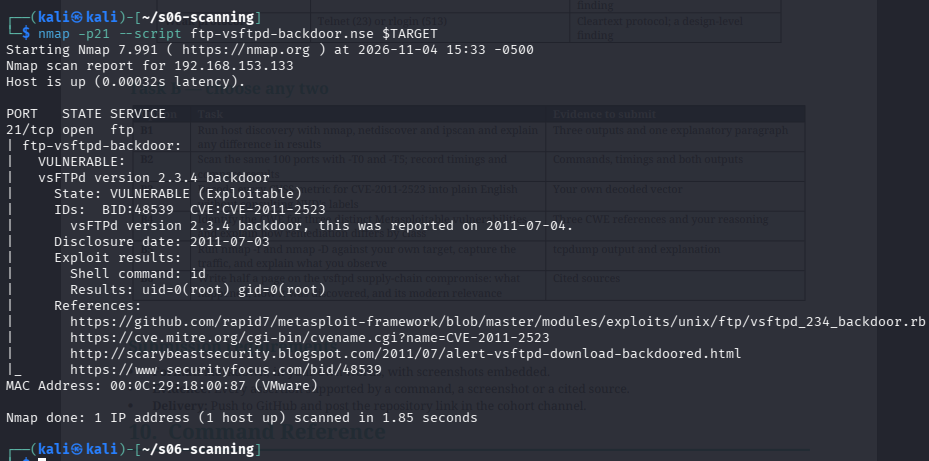
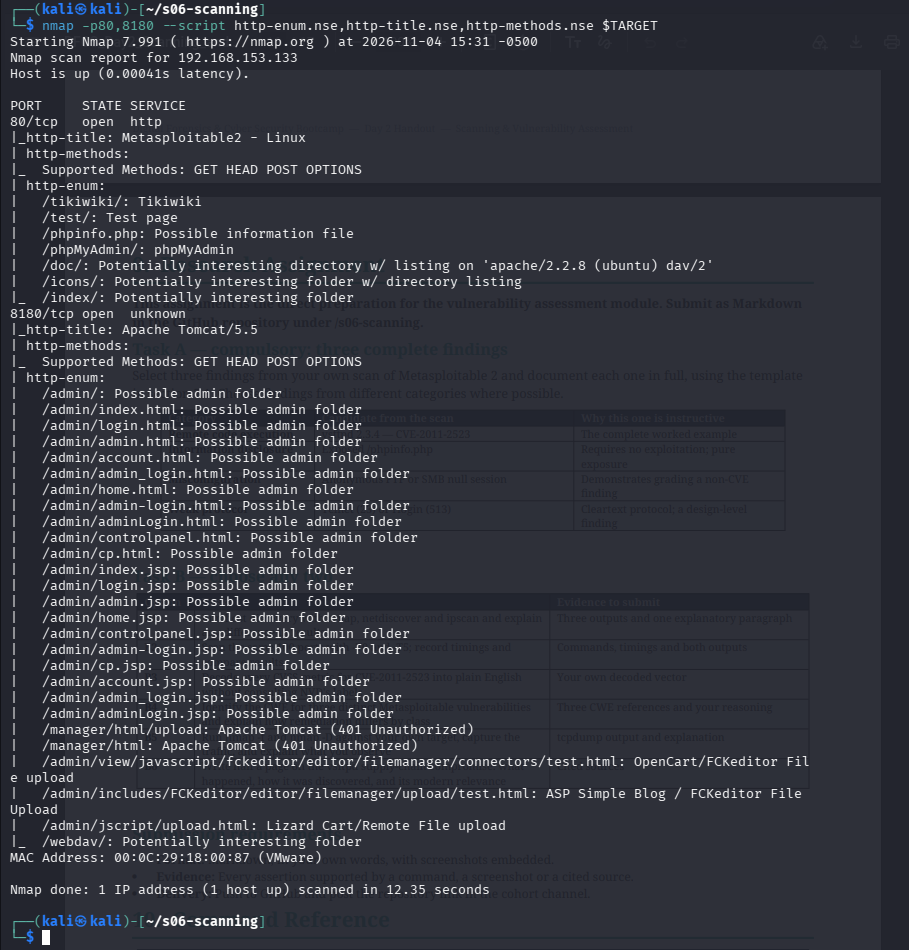
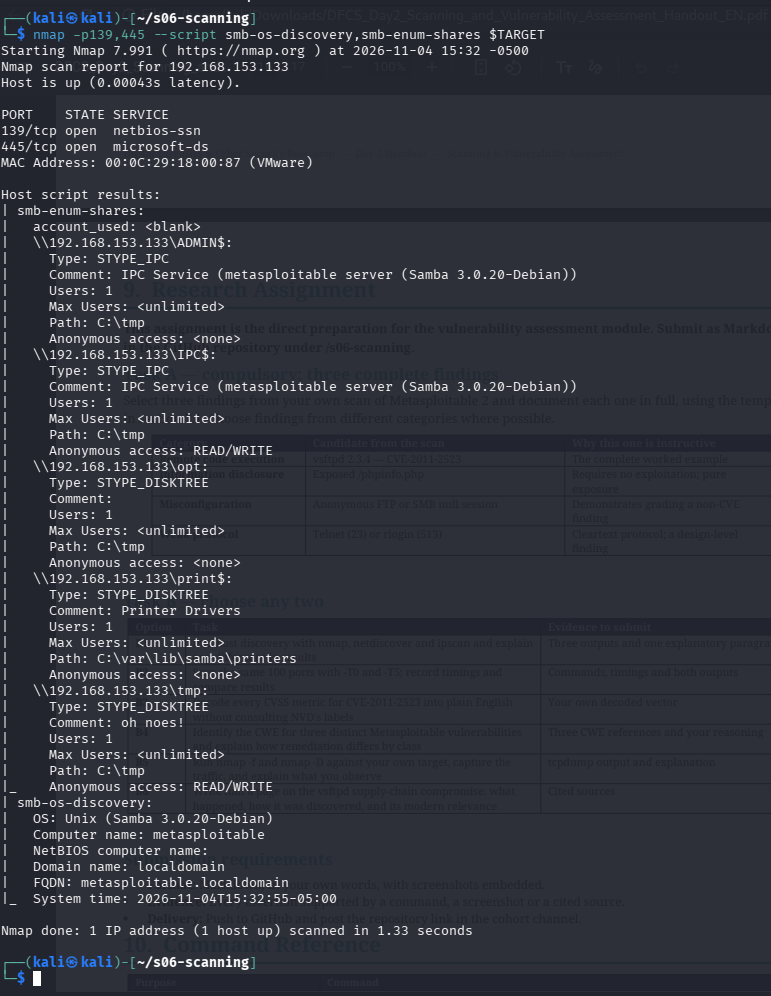

# DFCS Session — Homework (Day 2: Scanning & Vulnerability Assessment)

**Name:** MUHAMMAD ZAIN NASIR
**Cohort / Programme:** Atomcamp – Digital Forensics & Cyber Security
**Submitted:** Thursday 05 November 2026
**Lab target:** Metasploitable 2 at `192.168.153.133`, scanned from Kali at `192.168.153.128`, on an isolated NAT/host-only network. No command was run against any system outside this lab.
**Contents:** Task A (compulsory, three findings) · Task B3 · Task B4

---

## Task A — Three complete findings

### Finding 1 — Remote Code Execution

**TITLE** FTP Backdoor Command Execution in vsftpd 2.3.4

**SEVERITY** 9.8 Critical — `CVSS:3.1/AV:N/AC:L/PR:N/UI:N/S:U/C:H/I:H/A:H`

**ASSET** `192.168.153.133:21/tcp` — vsftpd 2.3.4

**IDENTIFIERS** CVE-2011-2523 | CWE-78 (OS Command Injection) | `cpe:/a:vsftpd:vsftpd:2.3.4`

**DESCRIPTION** The vsftpd 2.3.4 archive distributed between 30 June and 3 July 2011 contained a backdoor. A username containing a specific character sequence (`:)`) triggers code that opens a command shell on port 6200/tcp. The compromised archive was a supply-chain compromise on the download server, not a flaw in the vsftpd source code itself.

**EVIDENCE**
```
nmap -sV -p21 192.168.153.133 -> 21/tcp open ftp vsftpd 2.3.4
nmap -p21 --script ftp-vsftpd-backdoor.nse 192.168.153.133
  VULNERABLE: vsFTPd version 2.3.4 backdoor
  State: VULNERABLE (Exploitable)
  IDs: BID:48539 CVE:CVE-2011-2523
  Exploit results: Shell command: id -> Results: uid=0(root) gid=0(root)
Scan performed 4 November 2026, 15:33 -0500
```


**PROOF OF CONCEPT**
1. Connect to TCP 21 and supply a username containing the trigger sequence.
2. Confirm TCP 6200 opens: `nmap -p6200 192.168.153.133`
3. Connect to TCP 6200 and run `id`. The NSE script itself completed this and returned `uid=0(root) gid=0(root))`, confirming full root access with no credentials.

**IMPACT** Unauthenticated remote code execution as root, on a host that also runs MySQL (3306) and PostgreSQL (5432) — a compromise of this service exposes every database on the box.

**REMEDIATION** Upgrade vsftpd to a current, vendor-signed release. Never install packages from an unverified mirror.

**REFERENCES**
- https://cve.mitre.org/cgi-bin/cvename.cgi?name=CVE-2011-2523
- https://github.com/rapid7/metasploit-framework/blob/master/modules/exploits/unix/ftp/vsftpd_234_backdoor.rb
- http://scarybeastsecurity.blogspot.com/2011/07/alert-vsftpd-download-backdoored.html

---

### Finding 2 — Information Disclosure

**TITLE** Exposed PHP Information Page on Apache (`/phpinfo.php`)

**SEVERITY** 5.3 Medium (estimated) — `CVSS:3.1/AV:N/AC:L/PR:N/UI:N/S:U/C:L/I:N/A:N`

**ASSET** `192.168.153.133:80/tcp` — Apache httpd 2.2.8 (Ubuntu) DAV/2

**IDENTIFIERS** CWE-200 (Exposure of Sensitive Information to an Unauthorized Actor) | No CVE — this is a configuration exposure, not a product flaw | `cpe:/a:apache:http_server:2.2.8`

**DESCRIPTION** The web root serves a publicly reachable `phpinfo.php` page, found during `http-enum` script scanning. A `phpinfo()` page lists the PHP version, loaded modules, the full server filesystem path, environment variables and sometimes internal IP addresses — all without any authentication.

**EVIDENCE**
```
nmap -p80,8180 --script http-enum.nse 192.168.153.133
  /phpinfo.php: Possible information file
```


**PROOF OF CONCEPT**
1. Request `http://192.168.153.133/phpinfo.php` in a browser or with `curl`.
2. The page returns PHP configuration tables with no login required — this alone is the exposure; no exploitation step is needed.

**IMPACT** An attacker gains detailed knowledge of the server's software stack and file paths, which narrows down which other exploits to try. This finding requires no exploitation and is pure reconnaissance value handed to an attacker for free.

**REMEDIATION** Remove or restrict access to any `phpinfo()` file in a production environment. Never leave debug/info pages reachable from the internet.

**REFERENCES**
- https://www.php.net/manual/en/function.phpinfo.php
- https://cwe.mitre.org/data/definitions/200.html

---

### Finding 3 — Misconfiguration

**TITLE** Anonymous SMB Null Session Exposes Full Share List with Writable Access

**SEVERITY** 7.5 High (estimated) — `CVSS:3.1/AV:N/AC:L/PR:N/UI:N/S:U/C:H/I:L/A:N`

**ASSET** `192.168.153.133:139,445/tcp` — Samba smbd 3.0.20-Debian

**IDENTIFIERS** CWE-287 (Improper Authentication) | No CVE — this is a server misconfiguration, not a software bug | `cpe:/a:samba:samba:3.0.20`

**DESCRIPTION** The Samba service accepts a null session — a connection made with no username or password — and returns the full list of shares, including `ADMIN$`, `IPC$`, `opt`, `print$` and `tmp`. The `tmp` share additionally reports **Anonymous access: READ/WRITE**, meaning any unauthenticated user on the network can read and write files to it.

**EVIDENCE**
```
nmap -p139,445 --script smb-os-discovery,smb-enum-shares 192.168.153.133
  smb-enum-shares:
    account_used: <blank>
    \\192.168.153.133\tmp:
      Anonymous access: READ/WRITE
  smb-os-discovery:
    OS: Unix (Samba 3.0.20-Debian)
    Computer name: metasploitable
```


**PROOF OF CONCEPT**
1. `smbclient -L //192.168.153.133 -N` (the `-N` suppresses the password prompt — this is the null session).
2. The share listing returns without any credentials being supplied.
3. Connect to the `tmp` share and write a test file to confirm the READ/WRITE access the scan reported.

**IMPACT** Any device that can reach the network can read, plant or tamper with files in the `tmp` share, and can enumerate every other share name on the host with zero credentials — useful both for data theft and for staging further attacks (e.g. dropping a malicious file for another service to pick up).

**REMEDIATION** Disable anonymous/null session access in `smb.conf` (`restrict anonymous = 2`), remove anonymous write permission from all shares, and require authentication on every share.

**REFERENCES**
- https://cwe.mitre.org/data/definitions/287.html
- https://www.samba.org/samba/docs/current/man-html/smb.conf.5.html

---

## Task B3 — Decoding the CVE-2011-2523 CVSS vector into plain English

**Vector:** `CVSS:3.1/AV:N/AC:L/PR:N/UI:N/S:U/C:H/I:H/A:H`

| Metric | Value | My plain-English reading |
|---|---|---|
| **AV** — Attack Vector | N (Network) | The attacker doesn't need to be on the same machine or even the same network segment — this can be attempted from anywhere that can reach port 21 over the internet. |
| **AC** — Attack Complexity | L (Low) | There's no special trick or timing needed. The attacker just connects and sends the right username. It works the same way every time. |
| **PR** — Privileges Required | N (None) | The attacker doesn't need any account on the FTP server at all — not even a low-privilege one. |
| **UI** — User Interaction | N (None) | No employee, admin or user has to click anything or do anything for this to work. The attacker acts entirely alone. |
| **S** — Scope | U (Unchanged) | The damage stays inside the thing that was attacked (the FTP service/host). It doesn't automatically jump out and compromise a totally separate security boundary, like a different cloud account. |
| **C** — Confidentiality | H (High) | Because the attacker gets a root shell, they can read literally any file on the host — nothing is protected from them. |
| **I** — Integrity | H (High) | With root, they can change or delete any file or data on the host, including other services' databases. |
| **A** — Availability | H (High) | They can shut down any service or the whole machine, since root can stop anything. |

**My own summary of the score:** this scores 9.8 out of 10 because every condition that would normally lower a score is absent — no network position needed, no password needed, no user has to be tricked, and once in, the attacker owns the entire machine, not just a small part of it.

---

## Task B4 — CWE classification and how remediation differs by class

| # | Vulnerability | CWE | Why remediation is different for this class |
|---|---|---|---|
| 1 | vsftpd 2.3.4 backdoor (Finding 1) | **CWE-78** — OS Command Injection | The fix is **not** a configuration change — it's replacing the compromised binary itself with a clean, vendor-verified one. No setting in `vsftpd.conf` can undo malicious code embedded in the program. This is why supply-chain compromises are remediated by re-sourcing the software, not by hardening it. |
| 2 | SMB null session on `tmp` share (Finding 3) | **CWE-287** — Improper Authentication | The fix is a **configuration change**, not a software update: set `restrict anonymous = 2` and remove anonymous write permission in `smb.conf`. The Samba binary itself isn't flawed — it's doing exactly what it was told to do. |
| 3 | Anonymous FTP login allowed | **CWE-287** — Improper Authentication (same class as #2, different service) | Same remediation family as the SMB finding — disable the `anonymous_enable=YES` setting in `vsftpd.conf`. This shows why grouping by CWE matters: an administrator who fixes one CWE-287 finding should go check every other service on the host for the same setting, instead of treating each discovery as a one-off. |

**My reasoning:** CWE-78 findings are fixed by **replacing or patching the software**, because the mistake is baked into the code. CWE-287 findings are fixed by **changing configuration**, because the software behaves correctly but was told to trust too much. Grouping findings 2 and 3 under the same CWE also told me they share one root cause — this server was set up without any default-deny policy on authentication — so a single administrative decision (require auth everywhere) fixes both, rather than patching each service individually.
